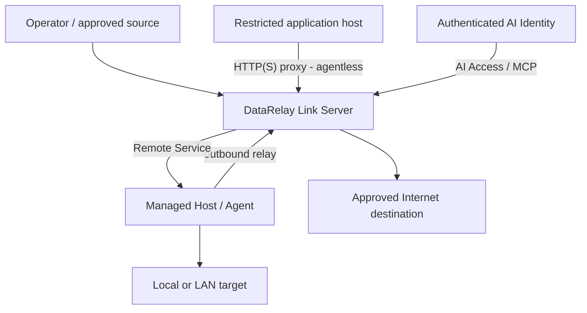

<div className="dr-hero-kicker">DATARELAY · SECURE CONNECTIVITY</div>

# DataRelay Link

**Relay only the connections that are actually needed. Do not join entire networks.**

DataRelay Link is a lightweight, CLI-first secure-connectivity gateway for isolated and restricted networks.

<div className="dr-hero-actions">
  <a className="dr-button dr-button-primary" href="/getting-started/quickstart">Quick Start</a>
  <a className="dr-button dr-button-secondary" href="/getting-started/concepts">Explore concepts</a>
</div>

<div className="dr-family-strip" aria-label="DataRelay product family">
  <a href="https://datarelay.run/">DataRelay</a>
  <span className="dr-family-current">Link</span>
  <a href="https://control.datarelay.run/">Control</a>
  <a href="https://grant.datarelay.run/">Grant</a>
  <a href="https://engineering.datarelay.run/">Engineering</a>
</div>

```text
Remote Access     outside → approved internal Remote Service
Internet Access   managed/protected source → approved outside destination
AI Access         authenticated AI Identity → approved target permissions
```

<Note>
  This manual covers product installation, operation and the three access policies. Start with [Quick Start](/getting-started/quickstart) or [MCP connection](/guides/mcp-clients).
</Note>

## Mental model



The key distinction is simple:

- **Remote Service** creates or represents connectivity.
- **Access Policy** decides whether that connectivity may be used.
- **Rules do not create Remote Services.**

For the complete object model, policy behavior, and role boundaries, read [Concepts & Mental Model](/getting-started/concepts).

## Policy defaults — three separate access controls

- **Remote Access:** No Policy/No Rules initially means **ALLOW**. In BLACKLIST, matching rules DENY and unmatched traffic ALLOW; in WHITELIST, matching rules ALLOW and unmatched traffic DENY. Disabled enforcement means **ALLOW ALL**.
- **Internet Access:** **WHITELIST only**. No matching enabled rule, no policy, or disabled enforcement means **DENY ALL**. BLACKLIST is not available.
- **AI Access:** **WHITELIST only**. Without an authenticated AI Identity and matching grant, access is **DENY**; disabled enforcement also means **DENY ALL**.
- Rules have no priority ordering or individual allow/deny action. Resetting a policy removes Mode/Rules and restores that plane's initial behavior. **Never disable Remote Access enforcement to lock down a published service.**

For first installation through final connection tests, follow [Choose your first workflow](/getting-started/choose-workflow).

## Choose your path

<CardGroup cols={2}>
  <Card title="Step-by-step use cases" icon="list-check" href="/use-cases/index">
    Copy the role-specific commands and verify real traffic, denied requests, and recovery.
  </Card>

  <Card title="Get started" icon="rocket" href="/getting-started/quickstart">
    Install a Server, enroll a Managed Host, and create a Remote Service.
  </Card>

  <Card title="Remote Access" icon="arrow-right-to-bracket" href="/guides/remote-access">
    Control who can use approved internal Remote Services.
  </Card>

  <Card title="Internet Access" icon="arrow-up-right-from-square" href="/guides/internet-access">
    Allow only approved outbound destinations.
  </Card>

  <Card title="AI Access / MCP" icon="robot" href="/guides/ai-access">
    Bind verified AI Identities to explicit target permissions.
  </Card>

  <Card title="CLI reference" icon="terminal" href="/drlink/cli-reference">
    Use the role-aware Server and Agent Host command grammar.
  </Card>

  <Card title="ConfigurationBundle" icon="file-code" href="/drlink/configuration-bundle">
    Validate, diff, and atomically apply dependent multi-resource changes.
  </Card>
</CardGroup>

## Product boundary

DataRelay Link relays explicitly configured services and approved destinations. It is not a full VPN, transparent network overlay, automatic cloud firewall/DNS manager, or large fleet-management platform.

External firewall/NAT rules, cloud security groups, DNS-provider records, OS accounts, and application certificates remain operator responsibilities unless a separately documented feature says otherwise.

For supported product boundaries and protocol limitations, see [Known Limits](/reference/limitations).

<Note>
  DataRelay Link is **Source Available**, not Open Source. See [License](/reference/license).
</Note>

## Claude and ChatGPT MCP tests complete

Real OAuth connection and core command/file workflows were verified with both clients. Start with [client setup](/guides/mcp-clients), [20 MCP tools](/reference/mcp-tools), and the [file/Git/job lab](/use-cases/ai-server-control). [MCP compatibility](/reference/mcp-validation) explains supported clients and access requirements.
