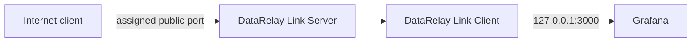
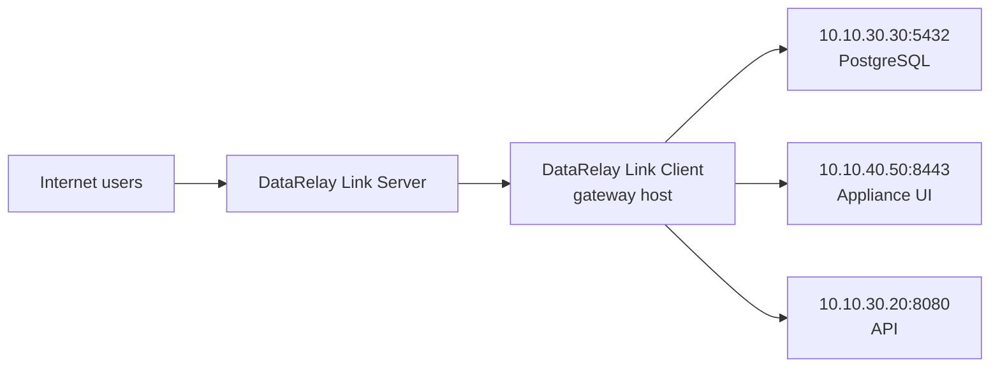
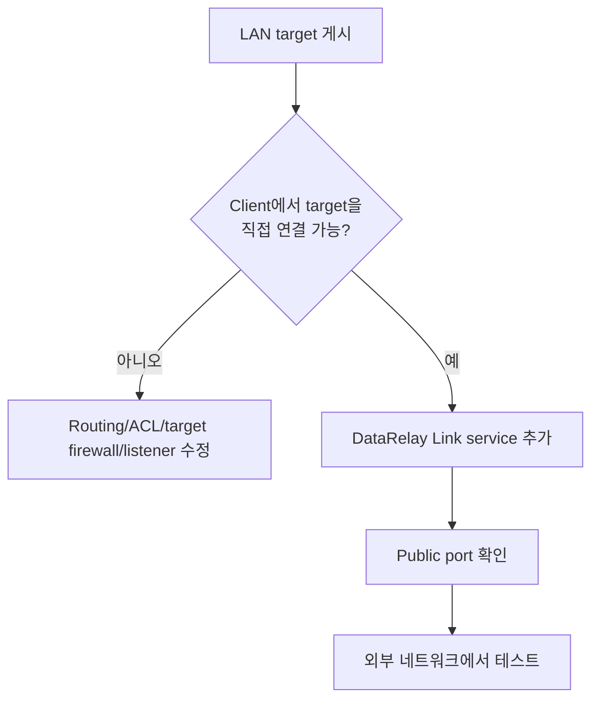

# Custom TCP & LAN Target

SSH/웹 외에도 Client가 연결할 수 있는 임의 **TCP target**을 게시할 수 있습니다.

## 신규 호스트는 Zero-Touch로 구성

Server에서 `set enrollment zero-touch`를 실행하고 플랫폼·호스트 이름·설명을 입력합니다. **Choose Remote Services**에서 서비스 유형과 대상 호스트·포트를 지정합니다. 발급된 명령을 대상 호스트에서 실행하면 선택한 서비스는 자동 구성됩니다. `show remote-services`로 실제 이름과 접속 주소를 확인하고, 같은 서비스를 아래 수동 절차로 중복 생성하지 않습니다.

## 기존 Agent에 추가할 때

아래 수동 구성은 이미 등록된 Agent에 **새 서비스**를 추가하는 경우입니다. 먼저 Server의 `show service-objects`와 Agent의 `show remote-services`로 기존 정의를 확인하고 없는 항목만 만드세요.

## Local TCP 예

```text
Grafana       127.0.0.1:3000
API           127.0.0.1:8080
Custom agent  127.0.0.1:9000
```



## Client를 LAN Gateway로 사용



DataRelay Link Client가 `target-host:target-port`로 normal TCP 연결을 할 수 있어야 합니다.

## 게시 전에 먼저 확인



## Service ID

사람이 이해할 수 있는 stable ID를 사용하세요.

```text
postgres-reporting
appliance-ui
branch-api
```

## 보안

데이터베이스나 어플라이언스 관리 포트를 외부 endpoint로 공개하면 인터넷에서 해당 서비스에 접근할 수 있게 됩니다. DataRelay Link는 데이터베이스 계정/ACL, 애플리케이션 인증, 대상 방화벽, 네트워크 분리를 대신 설정하지 않습니다.

<Warning>
  "포트가 연결된다"와 "서비스가 안전하게 공개되었다"는 같은 의미가 아닙니다. 대상 애플리케이션의 자체 인증과 권한 제어를 그대로 유지하십시오.
</Warning>

## 기존 Agent의 PostgreSQL 추가 예

Server에서 기존 Object를 확인한 뒤 필요한 정의를 만듭니다.

```text
set service-object postgres type tcp port 5432
```

해당 LAN에 도달 가능한 Agent REPL에서:

```text
set remote-service db-support destination 10.10.20.30 service postgres enabled
show remote-service db-support
```

이 예제의 대상은 **10.10.20.30:5432**이며 위 도식의 다른 주소를 그대로 섞지 마세요. 신규 호스트에서 Zero-Touch로 이미 같은 서비스를 선택했다면 이 수동 추가는 생략합니다.
