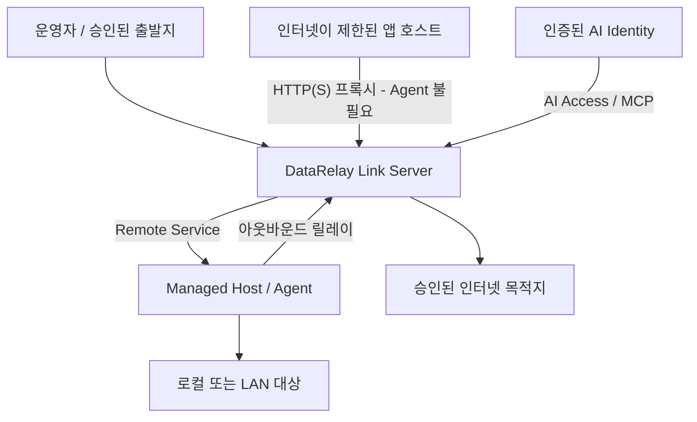

<div className="dr-hero-kicker">DATARELAY · SECURE CONNECTIVITY</div>

# DataRelay Link

**네트워크 전체를 연결하지 않고 실제로 필요한 연결만 중계합니다.**

DataRelay Link는 폐쇄망과 제한망을 위한 경량 CLI 중심 보안 연결 게이트웨이입니다.

<div className="dr-hero-actions">
  <a className="dr-button dr-button-primary" href="/ko/getting-started/quickstart">빠른 시작</a>
  <a className="dr-button dr-button-secondary" href="/ko/getting-started/concepts">핵심 개념</a>
</div>

<div className="dr-family-strip" aria-label="DataRelay 제품군">
  <a href="https://datarelay.run/ko">DataRelay</a>
  <span className="dr-family-current">Link</span>
  <a href="https://control.datarelay.run/ko">Control</a>
  <a href="https://grant.datarelay.run/ko">Grant</a>
  <a href="https://engineering.datarelay.run/ko">Engineering</a>
</div>

```text
Remote Access     외부 → 승인된 내부 Remote Service
Internet Access   Managed Host/보호 소스 → 승인된 외부 목적지
AI Access         인증된 AI Identity → 승인된 대상 Permission
```

<Note>
  현재 제품의 설치·운영과 세 가지 접근 정책을 설명합니다. 처음 사용한다면 [빠른 시작](/ko/getting-started/quickstart) 또는 [MCP 연결](/ko/guides/mcp-clients)을 선택하세요.
</Note>

## 현재 제품 모델

```text
Managed Host / DRLink Agent

Network Object / Network Group
Service Object / Service Group
Permission Object / Permission Group

AI Identity
Remote Service

Remote Access
Internet Access
AI Access

Remote Access: BLACKLIST / WHITELIST
Internet Access: WHITELIST only (default DENY)
AI Access: WHITELIST only (default DENY)
ConfigurationBundle
```

**Remote Service는 실제 연결을 만들고**, **Access Policy는 그 연결을 누가 사용할 수 있는지 결정합니다.** 정책 Rule이 Remote Service 자체를 만드는 것은 아닙니다.

## 연결 흐름



[제품 개념](/ko/getting-started/concepts)에서 Object, 정책 및 Server/Agent 역할을 자세히 확인할 수 있습니다.

## 정책 모델

정책의 초기 상태와 비활성화 의미는 연결 방향에 따라 **다릅니다.**

- **Remote Access:** No Policy/No Rules = **ALLOW**. BLACKLIST 매칭 Rule은 DENY이고 비매칭은 ALLOW입니다. WHITELIST 매칭은 ALLOW, 비매칭은 DENY입니다. Enforcement를 비활성화하면 **ALLOW ALL**입니다.
- **Internet Access:** **WHITELIST 전용, 기본 DENY**. 허용 Rule이 없거나 Enforcement가 비활성화되면 **DENY ALL**입니다. BLACKLIST는 불가능합니다.
- **AI Access:** **WHITELIST 전용, 기본 DENY**. Rule이 없거나 Enforcement가 비활성화되면 **DENY ALL**입니다. 실제 AI Identity 인증은 별도로 필요합니다.
- 세 정책 모두 Rule에 순서/개별 ALLOW·DENY action을 지정하지 않습니다. Policy Reset은 Mode와 Rule을 제거하며 각 연결 방향의 초기 정책 상태로 돌아갑니다.

사례별 명령과 실제 연결 확인은 [단계별 활용 사례](/ko/use-cases/index)를 이용하세요.

<CardGroup cols={2}>
  <Card title="단계별 활용 사례" icon="list-check" href="/ko/use-cases/index">
    SSH, 내부 웹, APT, Git, AI 접근부터 백업·복구까지 순서대로 따라 합니다.
  </Card>

  <Card title="빠른 시작" icon="rocket" href="/ko/getting-started/quickstart">
    Server 설치, Managed Host 등록, Remote Service 생성까지 진행합니다.
  </Card>
  <Card title="Remote Access" icon="arrow-right-to-bracket" href="/ko/guides/remote-access">
    Remote Service 사용 권한을 제어합니다.
  </Card>
  <Card title="Internet Access" icon="globe" href="/ko/guides/internet-access">
    승인된 외부 목적지만 허용합니다.
  </Card>
  <Card title="AI Access / MCP" icon="robot" href="/ko/guides/ai-access">
    인증된 AI Identity에 명시적 Permission을 부여합니다.
  </Card>
  <Card title="CLI Reference" icon="terminal" href="/ko/drlink/cli-reference">
    Server와 Agent Host 명령을 확인합니다.
  </Card>
  <Card title="ConfigurationBundle" icon="file-code" href="/ko/drlink/configuration-bundle">
    서로 의존하는 여러 설정을 한 번에 검증하고 변경 내용을 비교한 뒤 원자적으로 적용합니다.
  </Card>
</CardGroup>

## 제품 범위

DataRelay Link는 명시적으로 구성한 서비스와 승인한 목적지에 대한 연결만 중계합니다. 전체 VPN/네트워크 Overlay, 고객 클라우드 방화벽·DNS 자동 구성 또는 대규모 Fleet 관리 제품은 아닙니다.

외부 방화벽·NAT, 보안 그룹, DNS 레코드, OS 계정 및 애플리케이션 인증서는 별도 기능에 명시된 경우를 제외하면 운영자가 설정해야 합니다. [제한 사항](/ko/reference/limitations)을 참고하세요.

<Note>
  DataRelay Link는 **Source Available** 제품이며 Open Source는 아닙니다. [라이선스](/ko/reference/license)를 확인하세요.
</Note>

처음 설치해 SSH, 외부 허용 또는 MCP를 사용하려면 [목적별 신규 사용자 경로](/ko/getting-started/choose-workflow)를 따르세요.

## Claude · ChatGPT MCP 테스트 완료

실제 OAuth 연결, 명령·파일 작업을 두 클라이언트에서 확인했습니다. [연결 가이드](/ko/guides/mcp-clients), [20개 MCP 도구](/ko/reference/mcp-tools), [파일·Git·비동기 실습](/ko/use-cases/ai-server-control)에서 따라 해보세요. [MCP 호환성](/ko/reference/mcp-validation)에서 클라이언트 지원과 필요한 권한을 확인하세요.
