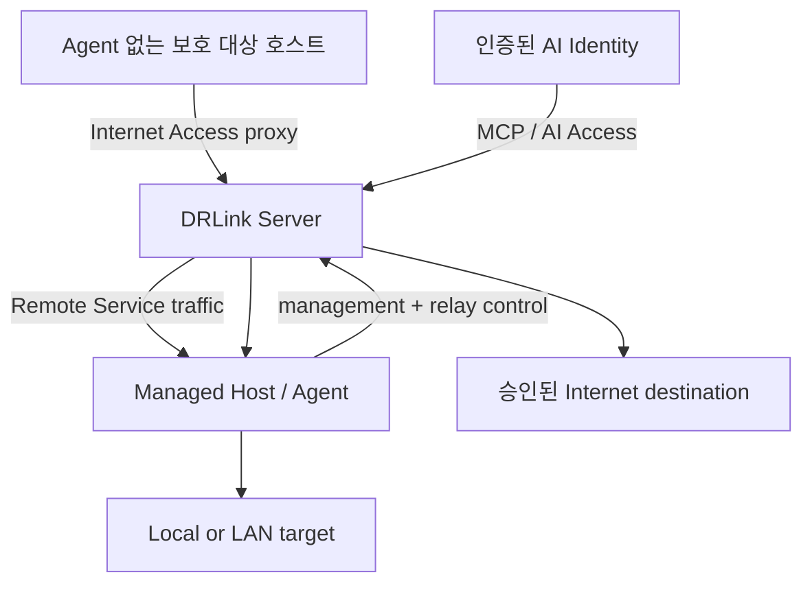

# 아키텍처

## 역할



Server는 Enrollment, Managed Host 목록, Network/Service/Permission Object와 Group, AI Identity, Access Policy, Revision, Audit, 백업/복구, Server ConfigurationBundle을 관리합니다.

Agent는 로컬 실행 상태와 Remote Service를 관리합니다. Remote Service는 하나의 목적지와 하나의 Service Object를 연결하고 고정된 DataRelay Link endpoint를 사용합니다.

| 정책 | 지원 모드 | 정책 없음 | Enforcement disabled |
| --- | --- | --- | --- |
| Remote Access | BLACKLIST / WHITELIST | ALLOW | ALLOW ALL |
| Internet Access | WHITELIST 전용 | DENY | DENY ALL |
| AI Access | WHITELIST 전용 | DENY | DENY ALL |

WHITELIST는 매칭 허용 Rule이 없으면 DENY입니다. BLACKLIST는 Remote Access에서만 지원하며 매칭하면 DENY, 미일치면 ALLOW입니다. Rule 순서와 Rule별 action은 없습니다. 정책 초기화는 Mode/Rule을 삭제하고 각 정책의 초기 상태로 돌아갑니다. AI 인증은 정책 상태와 별도로 항상 필요합니다.

Authoritative Server state는 다음 SQLite DB입니다.

```text
/var/lib/drlink/drlink.db
```

Enrollment 초기 인증 정보, 지속적인 Agent 관리 identity, Relay Engine 인증 정보, AI OAuth 인증 정보는 서로 다른 신뢰 경계에 속합니다.

MCP는 Server에서 인증되는 연결 계층이며 AI Access 정책, Agent identity, 대상 OS 권한을 우회하지 않습니다.

Server-self MCP는 등록된 Agent와 별도의 명시적 대상 server:self입니다. [MCP 연결](/ko/guides/mcp-clients)을 참고하세요.
