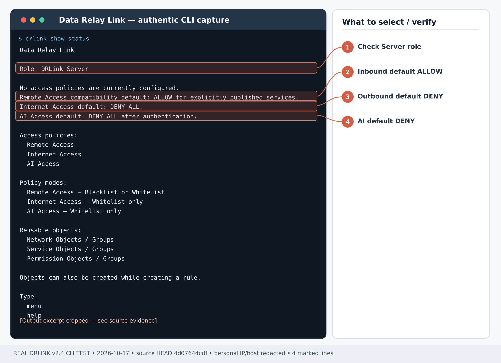
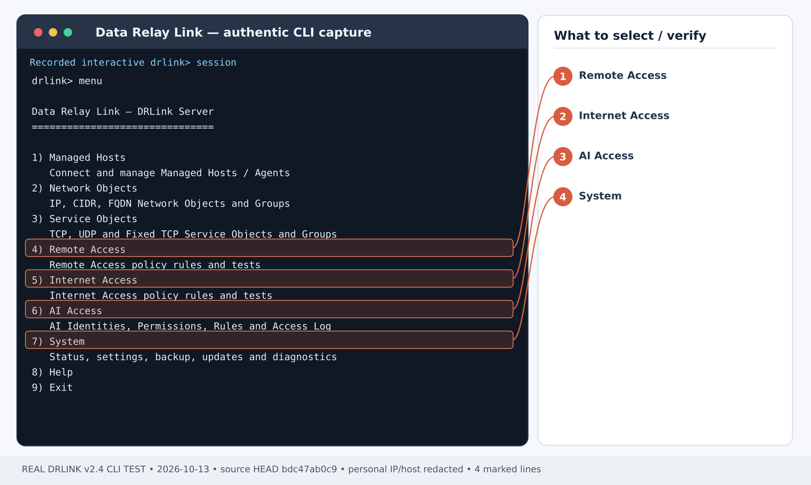

# AI에게 MCP 전체 권한을 명시적으로 부여하기

**목표:** 승인한 Claude·ChatGPT의 AI Identity가 지정된 Managed Host에서 **7개 MCP 기능 전체**를 사용하도록 설정합니다. 필요할 때만 **별도 Rule**로 `server:self`의 파일·셸·Git·비동기 작업을 허용합니다. 대상 OS 권한이나 AI 클라이언트 자체의 승인 절차를 우회하는 기능은 아닙니다.

<Warning>
  **Full 권한은 선택적 관리자 권한입니다.** `command-exec`는 Data Relay Link에 설정된 OS 실행 계정 권한으로 명령을 실행하며 `paths`나 `cwd`로 셸 접근 범위가 제한되지 않습니다. 승인된 운영/실습용 호스트와 전용 AI Identity에만 적용하세요.
</Warning>

*그림 1. 권한을 부여하기 전 실제 Server 상태 화면이며 AI 전체 권한 실행 성공 화면이 아닙니다.*

*그림 2. 실제 Server 설정 메뉴이며 전체 권한 변경과 확인은 별도 절차로 수행합니다.*

*그림 1. 실제 Server CLI 메뉴. Full 권한 설정 성공을 입증하는 캡처는 아닙니다.*

*그림 2. 실제 Server 보안 상태. 본인 환경의 실제 권한은 정책 변경 후 별도 확인합니다.*

## 1단계 — Server 설치와 공개 MCP 주소 준비

[Server 설치](/ko/getting-started/server-installation)를 완료하고 공개 MCP는 **single443** 모드로 구성합니다. [MCP 클라이언트 연결](/ko/guides/mcp-clients)과 [Firewall/NAT](/ko/deployment/firewall-nat)에 따라 DNS·공인 인증서·외부 방화벽을 준비합니다. AUTO_ACME HTTP-01을 사용하면 인증서 발급 시 TCP/80도 필요합니다.

**Server OS 셸:**

~~~bash
sudo drlink system version
sudo drlink show status
sudo drlink system diagnostics mcp
sudo drlink system certificate status
~~~

실제 `https://mcp.example.net/mcp` 주소와 OAuth discovery 응답을 확인합니다. **direct** 모드에서 Relay TCP/443이 연결된다는 이유만으로 공개 MCP가 준비된 것은 아닙니다.

## 2단계 — Managed Host 등록

기존 Agent가 있으면 재등록하지 말고 사용합니다. 신규 등록은 [Managed Host 등록](/ko/guides/enrollment)을 따르세요. MCP만 쓸 **관리 전용 등록**에서는 **Server REPL**에서:

~~~text
set enrollment bulk
~~~

개수 **1**, SSH 사용자명 **빈칸**을 선택해 Remote Service를 만들지 않습니다. 생성된 일회성 설치 명령은 **등록할 실제 호스트**에서 실행합니다. Bootstrap 명령과 티켓은 민감 정보로 보호하세요.

**Server REPL:**

~~~text
show managed-hosts
show managed-host branch-a
~~~

아래 `branch-a`는 실제 등록된 호스트명으로 바꿉니다. Managed Host MCP는 Server→Agent를 통해 실행하므로 외부 SSH 포트나 Remote Access Rule이 필요하지 않습니다.

## 3단계 — AI Identity 및 OAuth 인증

**Server REPL:**

~~~text
set ai-identity operator-ai
system credential configure ai-identity operator-ai authentication oauth
show ai-identity operator-ai
~~~

[Claude 또는 ChatGPT](/ko/guides/mcp-clients)에 `https://mcp.example.net/mcp`를 등록합니다. 브라우저에서 실제 클라이언트와 요청 Identity를 확인한 다음 **Server OS 셸**에서 다음을 실행합니다.

~~~bash
sudo drlink system credential approve-oauth <PENDING-ID> operator-ai
~~~

최초 승인한 Owner에게는 Managed Host에 대한 `mcp-owner-full-access` Rule이 이미 존재할 수 있습니다. OAuth 연결만으로 임의의 Server 권한이 생기는 것은 아니므로 기존 Rule 전체를 확인한 뒤 추가합니다. 읽기 전용 검증에는 별도 non-owner Identity를 쓰세요.

## 4단계 — Managed Host에 7개 전체 권한 부여

전체 기능은 `host-info`, `process-read`, `file-read`, `file-write`, `file-upload`, `file-download`, `command-exec`입니다.

**Server REPL:**

~~~text
set permission-object operator-full permissions host-info,process-read,file-read,file-write,file-upload,file-download,command-exec
set ai-access operator-full-host mode whitelist source operator-ai destination branch-a permission operator-full paths '/*' enabled
set ai-access enabled
show permission-object operator-full
show ai-access operator-full-host
test ai-access source operator-ai destination branch-a permission command-exec
test ai-access source operator-ai destination branch-a permission file-read path /etc/hostname
~~~

`/*`는 전체 파일 경로를 폭넓게 허용하기 위한 **의도적인 Full 설정**입니다. 실제 파일 접근은 OS 권한을 따릅니다. `command-exec`는 별도의 셸 실행 권한이므로 파일 경로 제한을 안전한 셸 격리 기능으로 오해하면 안 됩니다. 다른 Managed Host를 허용하려면 **해당 호스트별 Rule**을 추가하거나 대상 그룹을 명시적으로 검토합니다.

## 5단계 — 선택적으로 Server 자체 전체 권한 부여

이 설정은 Managed Host만 제어할 때 **필요하지 않습니다**. Server 자체의 파일·명령·Git·Job 제어가 필요한 경우에만 **별도 Rule**을 추가합니다.

~~~text
set ai-access operator-full-server mode whitelist source operator-ai destination server:self permission operator-full paths '/*' enabled
show ai-access operator-full-server
test ai-access source operator-ai destination server:self permission command-exec
test ai-access source operator-ai destination server:self permission file-read path /etc/hostname
~~~

`server:self`의 `server_*` 도구는 **Server OS 실행 계정**을 사용하며 Agent 권한과 구분됩니다. `cwd`는 샌드박스가 아닙니다. 범위를 좁힌 실습은 [Server 파일·Git·Job 제어](/ko/use-cases/ai-server-control)를 참고하세요.

## 6단계 — 실제 MCP 허용·차단 검증

OAuth로 연결된 실제 AI 클라이언트에서 다음 순서로 확인합니다.

1. `list_hosts`, `get_system_info`, `list_processes`로 승인한 Managed Host 조회
2. `exec`로 승인 호스트에 안전한 `id` 명령 실행, exit status·실행 계정 확인
3. 승인한 임시 디렉터리에서 `read_file`, `write_file`, `upload_file`, `download_file` 검증 후 본인 파일만 정리
4. **5단계를 설정했을 때만** `get_server`, `server_exec`의 `id`, `server_read_file` 및 임시 작업공간에서 Git/Job 검증
5. 다른 **미승인 Managed Host**에서 `exec` 요청해 다른 Rule이 없는 경우 **DENY** 확인

**Server REPL:**

~~~text
show ai-access
show ai-access-log identity operator-ai
~~~

`test ai-access`의 ALLOW는 정책 시뮬레이션입니다. 실제 MCP 호출 성공 및 Agent/OS 권한까지 확인해야 E2E 성공입니다. AI 클라이언트 자체의 추가 승인 여부도 별도 기록하세요.

## 7단계 — 권한 축소·철회

실습에 사용하지 않는 Rule만 선택적으로 제거합니다.

~~~text
show ai-access
unset ai-access operator-full-server
unset ai-access operator-full-host
show ai-access
~~~

5단계를 생략했다면 `operator-full-server` 제거 명령도 생략하세요. Permission Object 또는 AI Identity 삭제/토큰 폐기는 다른 이용자를 확인한 후 별도로 수행합니다. 기존 Owner Rule이나 다른 AI 정책을 일괄 초기화하지 마세요.

권한을 줄이려면 [읽기 전용 MCP](/ko/use-cases/ai-readonly)와 [AI Access](/ko/guides/ai-access), 사람의 SSH 접속 ACL은 [Remote Access](/ko/guides/remote-access), 내부→외부 접근은 [Internet Access](/ko/guides/internet-access)를 따릅니다. 세 영역은 **서로 다른 정책**입니다.
