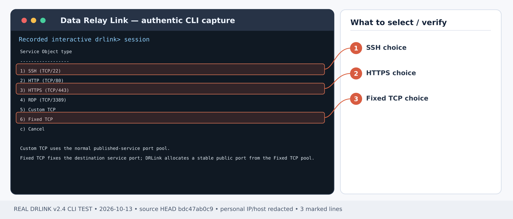
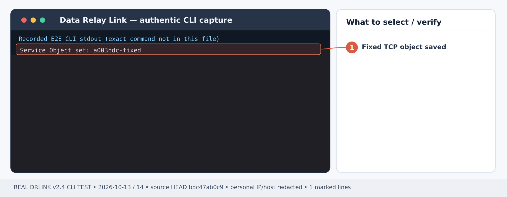
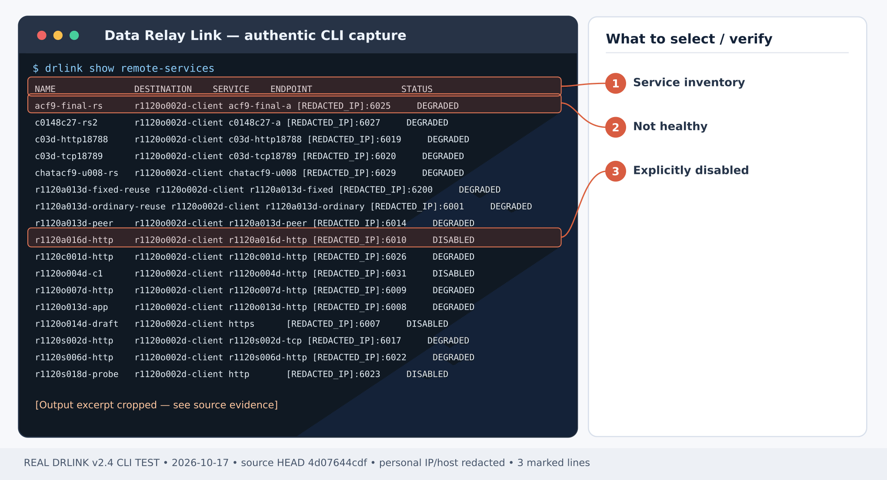

# Fixed TCP로 내부 레거시 데이터베이스 접근하기

## 처음 설치부터 시작하기 — Remote Access

**시나리오별 최초 사용 순서:** [Server 설치](/ko/getting-started/server-installation) 및 **Fixed TCP 전용 공개 포트 풀**·[NAT/방화벽](/ko/deployment/firewall-nat) 확인 → DB가 있는 LAN에 접근 가능한 [Agent 등록](/ko/guides/enrollment) → Gateway에서 DB 리스너·계정·TLS 확인. 아래는 기존 Agent에 **새 DB 서비스**를 추가하는 수동 절차입니다. 등록 시 이미 생성한 동등한 서비스를 중복 만들지 마세요. 서비스 공개 전에 DBA 출발지의 [Remote Access WHITELIST](/ko/guides/remote-access)를 설정하고 실제 DB 클라이언트로 연결을 검증합니다.

1. [Server 설치](/ko/getting-started/server-installation)를 먼저 완료하고 [Direct/single443 모드](/ko/deployment/modes), [방화벽·NAT](/ko/deployment/firewall-nat)의 제어 연결과 실제 공개 서비스 포트를 허용합니다. 외부 방화벽은 제품이 자동 변경하지 않습니다.
2. **Server REPL에서 Managed Host를 등록**하고 생성된 Zero-Touch 명령을 대상 **Agent Host**에서 실행합니다. [등록 안내](/ko/guides/enrollment)를 따르세요. SSH only로 등록하면 Service Object, Remote Service, 공개 endpoint가 **자동 생성되므로 중복 생성하지 않습니다**. LAN gateway 또는 추가 Custom TCP 서비스는 필요에 맞게 관리 전용 등록 후 Server Object를 준비하고, 해당 Agent에서 새 Remote Service를 만듭니다.
3. **인바운드 ACL을 명시적으로 설정**합니다. Remote Access는 No Policy 또는 enforcement disabled일 때 **ALLOW ALL**입니다. 실제 외부 출발지 Network Object와 Managed Host·Service Object를 지정한 WHITELIST를 [사무실 IP 제한 실습](/ko/use-cases/office-allowlist)처럼 설정하고 허용·차단을 모두 확인합니다.
4. **Server 셸**에서 설치 상태를 확인한 뒤 아래 개별 시나리오를 진행합니다.

~~~bash
sudo drlink system version
sudo drlink show status
sudo drlink show managed-hosts
sudo drlink show remote-access
~~~

5. 실제 할당된 공개 endpoint를 이용하여 허용된 외부 PC에서 SSH/HTTPS/TCP를 연결하고, 미허용 출발지에서는 DENY되는지 감사 기록까지 확인합니다. 정책 ALLOW만으로 실통신 성공은 아닙니다.

<Note>Remote Access에는 대상 또는 LAN gateway의 Agent가 필요합니다. MCP AI 권한이나 Internet Access 정책은 인바운드 Remote Service를 대신 생성하지 않습니다.</Note>

**완성 결과:** 외부 DBA PC에서 승인된 출발지로만 내부 DB 리스너에 연결합니다. DB 서버와 사내 전체망을 공개하지 않습니다.

예제: 승인 DBA 공인 IP **203.0.113.10** → DRLink → 지점 Agent → 내부 DB **10.50.1.20:1521**.

<Note>
  이 사례는 **인바운드 Fixed TCP Remote Service**입니다. 별개의 **아웃바운드 Internet Access Fixed TCP** 프록시 리스너를 설정하는 방법이 아닙니다.
</Note>

## 1단계 — DB와 게이트웨이 준비

게이트웨이 Agent OS에서 **10.50.1.20:1521**에 접근 가능한지 확인합니다. DB 인증, TLS/암호화, 계정 및 운영 방화벽은 별도로 유지해야 합니다. DRLink는 DB 사용자를 생성하지 않습니다.

## 2단계 — 목적지와 Fixed TCP Service Object 등록

*그림 1. 실제 Service Object 유형 선택: SSH는 1번, HTTPS는 3번, Fixed TCP는 6번입니다. 제품 CLI 출력 예시; 일부 주소·호스트는 가렸습니다.*

*그림 2. 실제 Fixed TCP Service Object 생성 확인 출력입니다. 공인 포트 할당과 DB 실제 접속은 별도로 검사해야 합니다. 제품 CLI 출력 예시; 일부 주소·호스트는 가렸습니다.*

**Server REPL:**

~~~text
set network-object branch-db type ip value 10.50.1.20
set network-object dba-public type ip value 203.0.113.10
set service-object oracle-db type fixed-tcp port 1521
show service-object oracle-db
show managed-hosts
~~~

Agent 게이트웨이의 실제 Managed Host 이름(예: **branch-gateway**)을 확인합니다. Fixed TCP는 일반 TCP와 별도의 공인 엔드포인트 풀을 사용하므로 기존 Remote Service의 포트 풀 유형을 임의로 변경하지 마세요.

## 3단계 — 서비스를 공개하기 전에 출발지 제한

**Server REPL:**

~~~text
set remote-access dba-to-db mode whitelist source dba-public destination branch-gateway service oracle-db enabled
set remote-access enabled
test remote-access source dba-public destination branch-gateway service oracle-db
show remote-access
~~~

**확인:** DBA 출발지 ALLOW, 기존 다른 Rule에서 원치 않는 출발지가 허용되지 않는지 검토.

## 4단계 — 게이트웨이 Agent에서 실제 서비스 생성

*그림 3. 실제 Remote Service 목록: DEGRADED와 DISABLED 상태를 구분하고, 목록 표시만으로 실통신 성공을 판단하지 않습니다. 제품 CLI 출력 예시; 일부 주소·호스트는 가렸습니다.*

**Gateway Agent REPL:**

~~~text
set remote-service branch-oracle destination branch-db service oracle-db enabled
show remote-service branch-oracle
~~~

**확인:** 할당된 공인 Fixed TCP 포트와 런타임 상태를 기록합니다. 연결이 임시로 불가능하면 DEGRADED일 수 있고, 임의로 성공 판정하지 않습니다.

## 5단계 — DB 클라이언트 통신 확인

허용된 외부 DBA PC에서 TCP 리스너 확인:

~~~bash
nc -vz <drlink-public-host> <allocated-fixed-tcp-public-port>
~~~

그다음 실제 **DB 벤더 클라이언트**에서 이 호스트/포트와 올바른 DB 계정으로 로그인·조회합니다. **nc 성공은 TCP 핸드셰이크만 검증**하므로 실제 DB 쿼리 성공까지 확인해야 합니다. 비허용 공인 IP에서는 접속 거부 및 DRLink 감사 기록을 확인하세요.

## 장애/서비스 제거

실패하면 Server 정책, Agent `system diagnostics`, DB 서비스 리스너, 외부 포트 개방을 각각 점검합니다. DB 자체 인증/TLS는 그대로 필요합니다. 서비스 철회 시 소유 Agent에서 `unset remote-service branch-oracle`로 해당 Remote Service만 제거합니다. 운영 DB 세션 중단 가능성을 검토한 뒤 실행하세요.

## 최신 동작 확인 — 2026-10-28

Fixed TCP는 별도 Server 엔드포인트 풀을 쓰는 Service Object 하위 유형입니다. 기존 Remote Service를 표준 TCP/Fixed TCP 풀 사이에서 제자리 변경할 수 없습니다. 공개 포트가 DB 대상 포트와 같다고 가정하지 말고 show remote-service branch-oracle 결과를 사용하세요.

[현재 CLI 전체 목록](/ko/drlink/cli-reference) · [MCP 호환성](/ko/reference/mcp-validation)
