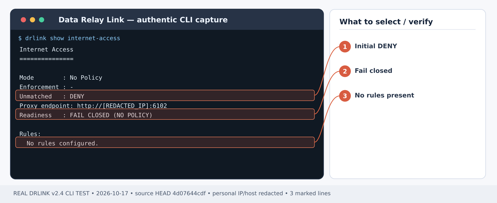
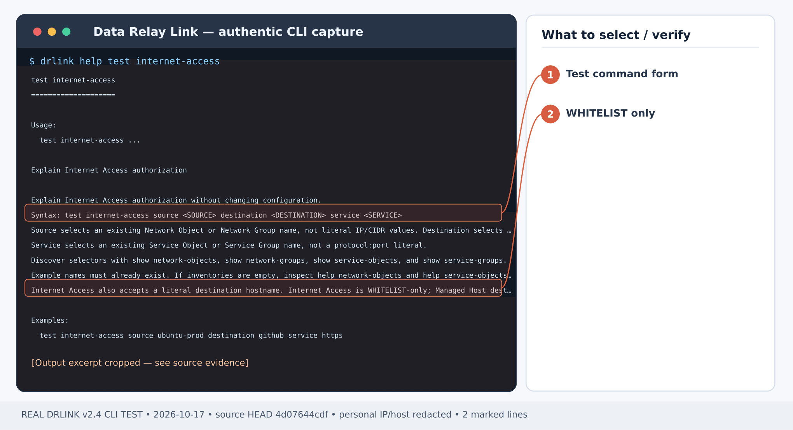
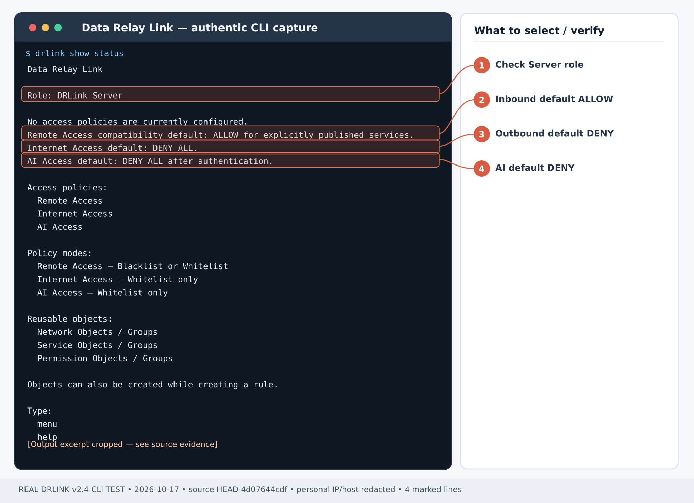

# Internet Access를 통해 GitHub Git·API만 사용하기

## 처음 설치부터 시작하기 — 내부에서 외부로 허용

**시나리오별 최초 사용 순서:** [Server 설치](/ko/getting-started/server-installation) → 보호 호스트가 Internet Access 프록시 포트에 접속 가능한지, **Server에서** 외부 DNS/Internet 통신이 가능한지 확인. 프록시를 지원하는 Git/curl은 Agent가 필요 없습니다. 방화벽에는 출발지→프록시 포트만 허용하고, **NAT 후 실제 출발지 IP/CIDR** 및 GitHub/API의 정확한 FQDN+TCP 포트를 Object로 등록해 [Internet Access WHITELIST](/ko/guides/internet-access)를 구성합니다. Git 리다이렉트/콘텐츠 도메인은 트래픽을 보고 필요한 것만 추가합니다. 실제 Git/curl 허용과 무관한 목적지 차단을 모두 확인하세요.

1. [Server 설치](/ko/getting-started/server-installation)를 완료하고 실제 Internet Access 프록시의 수신 IP/포트를 진단합니다. [방화벽·NAT](/ko/deployment/firewall-nat)에서 **보호 호스트 → Server 프록시 포트**를 허용하고, 보호 호스트의 직접 인터넷 접속은 외부 방화벽에서 계속 제한합니다.
2. 일반 HTTP(S) 프록시 방식에는 보호 호스트의 **Agent 등록이나 Remote Service 생성이 필요 없습니다**. Server에서 프록시가 관찰하는 출발지 IP/CIDR(특히 NAT 이후 주소), 목적지 FQDN 및 TCP 포트 Service Object를 만듭니다.
3. [Internet Access](/ko/guides/internet-access) WHITELIST Rule을 생성·활성화하고 허용·차단을 모두 검사합니다. Internet Access는 No Policy 및 enforcement disabled를 포함해 **기본 DENY**입니다.
4. 보호 호스트에서 실제 Server 프록시 주소로 HTTP_PROXY/HTTPS_PROXY 또는 앱 전용 프록시를 설정하고 HTTP/HTTPS CONNECT **실통신**, 미허용 목적지 DENY, Server 감사 기록을 검증합니다. 직접 인터넷 통신 성공이나 정책 테스트 ALLOW만으로는 통과가 아닙니다.

**Server 셸 기본 확인:**

~~~bash
sudo drlink system version
sudo drlink show status
sudo drlink show internet-access
sudo drlink system diagnostics
~~~

**완성 결과:** 제한망의 개발/운영 호스트가 Git 메타데이터를 가져오고 필요한 HTTPS API를 호출하지만, DRLink 프록시를 통한 무관한 인터넷 사이트 접근은 거부됩니다.

예제: 보호 호스트 **10.20.30.16** → 프록시 **10.20.30.5:6080** → **github.com:443**, **api.github.com:443**만.

## 1단계 — 프록시 엔드포인트 점검

*그림 1. Internet Access 설정 이전의 실제 출력: No Policy·Unmatched DENY·FAIL CLOSED입니다. 허용된 트래픽 성공 화면이 아닙니다. 제품 CLI 출력 예시; 일부 주소·호스트는 가렸습니다.*

**Server REPL:**

~~~text
show internet-access
system diagnostics
~~~

설치 시 지정된 실제 프록시 리스너 IP/포트를 기록합니다. 외부 방화벽은 승인된 보호 호스트에서만 이 포트에 도달하도록 관리자가 설정합니다.

## 2단계 — 출발지/목적지 Object 구성

**Server REPL:**

~~~text
set network-object git-source type ip value 10.20.30.16
set network-object github-site type fqdn value github.com
set network-object github-api type fqdn value api.github.com
set service-object https443 type tcp port 443
~~~

서버가 관측하는 NAT 변환 후 IP가 예제와 다르다면 그 실제 출발지로 대체합니다.

## 3단계 — 인터넷 허용 정책 생성

*그림 2. 실제 도움말: test internet-access는 사전 생성된 Object/Group으로 정책을 검사하며 실트래픽 테스트를 대체하지 않습니다. 제품 CLI 출력 예시; 일부 주소·호스트는 가렸습니다.*

**Server REPL:**

~~~text
set internet-access git-https mode whitelist source git-source destination github-site service https443 enabled
set internet-access api-https source git-source destination github-api service https443 enabled
set internet-access enabled
show internet-access
test internet-access source git-source destination github-site service https443
test internet-access source git-source destination github-api service https443
~~~

**확인:** 정확히 지정한 두 FQDN/포트에 대해서만 ALLOW, 다른 목적지는 DENY. 기존 Rule/Group이 광범위한 접근을 허용하지 않는지도 함께 확인합니다.

## 4단계 — 보호 호스트에서 실제 Git·curl 전송

영구 로그인 셸의 프록시 환경을 변경하지 않도록 **서브셸**로 실행합니다.

~~~bash
(
  PROXY_URL="http://10.20.30.5:6080"
  export http_proxy="$PROXY_URL" https_proxy="$PROXY_URL"
  export HTTP_PROXY="$PROXY_URL" HTTPS_PROXY="$PROXY_URL"
  bypass="${no_proxy:-}"
  if [ -n "${NO_PROXY:-}" ]; then bypass="${bypass:+${bypass},}${NO_PROXY}"; fi
  bypass="${bypass:+${bypass},}127.0.0.1,localhost"
  export no_proxy="$bypass" NO_PROXY="$bypass"

  no_proxy= NO_PROXY= git -c http.proxy="$PROXY_URL" ls-remote https://github.com/git/git.git HEAD
  curl --noproxy '' --proxy "$PROXY_URL" --head --show-error https://api.github.com/
  curl --noproxy '' --proxy "$PROXY_URL" --head --show-error https://example.org/
)
~~~

**성공 기준:** Git HEAD SHA가 출력되고 Git/API 요청이 실제 프록시를 통과해야 합니다. API 서버 자체의 Rate Limit 응답은 DRLink 정책 DENY와 구별하세요. example.org는 정책상 명시적 DENY여야 합니다. 상속된 **no_proxy/NO_PROXY**에 해당 공인 도메인이 있다면 테스트 범위에서만 제거하여 직접 인터넷 우회를 방지합니다.

## 5단계 — 감사 로그 대조

*그림 3. 정책 설정 이전의 실제 Server 상태: Remote Access는 초기 ALLOW, Internet Access와 AI Access는 기본 DENY입니다. 제품 CLI 출력 예시; 일부 주소·호스트는 가렸습니다.*

**Server REPL:**

~~~text
show internet-access
system audit
system diagnostics
~~~

보호 호스트 IP, 목적지 FQDN/포트, 매칭 Rule, 실제 허용/차단 결과를 확인합니다. `test internet-access의 ALLOW만으로 데이터 전송 성공이라고 판단하지 않습니다.`

## 문제 해결 및 추가 도메인

Git이 계속 DENY되면 실제 Git 원격 URL, NAT 출발지, DNS 호스트명 및 정책을 확인합니다. git clone이 추가로 **codeload.github.com** 등 다른 도메인에 접근한다면 실제 로그에 나타난 FQDN만 개별 허용합니다. TLS 오류는 목적지 인증서/신뢰 문제이고, 프록시 timeout은 정책 DENY와 다릅니다. Internet Access enforcement를 disabled로 변경하면 모든 신규 접근이 DENY됩니다.

## 최신 동작 확인 — 2026-10-28

애플리케이션 테스트에서 프록시를 명시하고 해당 호출에 한해서만 공인 호스트 no_proxy 우회를 비웁니다. Managed Host source는 실제 프록시 peer IP가 입증되는 활성 주소일 때만 매칭합니다. NAT 뒤에서는 관측한 IP/CIDR을 사용하세요. FQDN 허용이 UDP나 사설/metadata 대상 우회를 의미하지 않습니다.

[현재 CLI 전체 목록](/ko/drlink/cli-reference) · [MCP 호환성](/ko/reference/mcp-validation)
