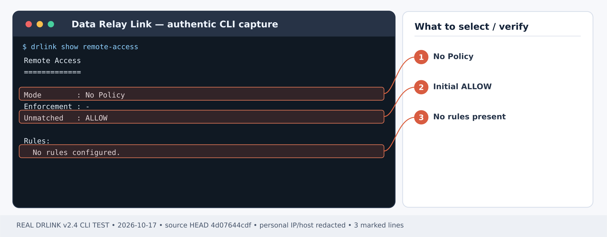
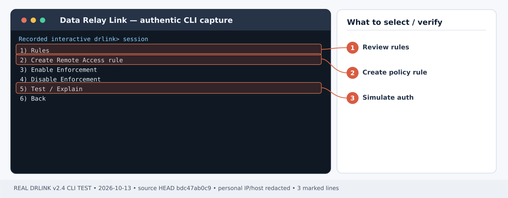
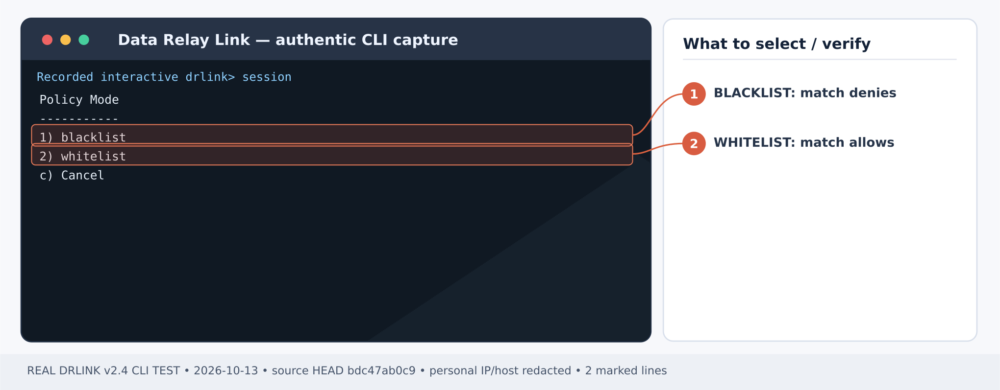
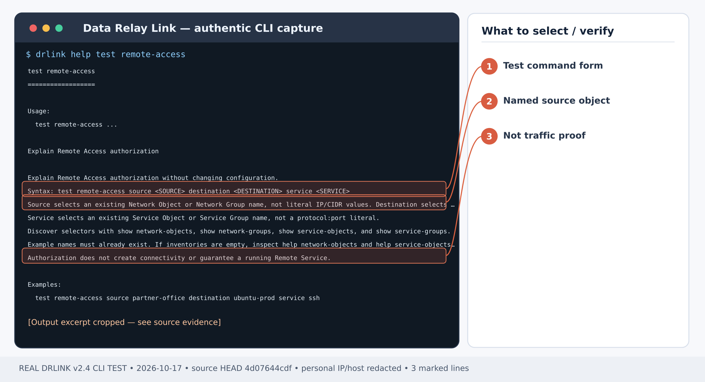

# 사무실 IP 한 곳에서만 원격 SSH 접속 허용하기

## 첫 사용 전 — 설치부터 확인

**신규 사용자 순서:** [Server 설치](/ko/getting-started/server-installation) → [SSH Agent 등록](/ko/guides/enrollment) → Agent에서 실제 `show remote-services`로 Remote Service와 Service Object 이름 확인. Zero-Touch SSH-only가 생성한 객체를 중복 만들지 마세요. 사무실의 **NAT 후 공인 IP**와 독립적인 미승인 외부 테스트 출발지를 확보합니다. 정책이 없는 Remote Access는 **ALLOW**이며, enforcement 비활성화 또는 정책 초기화도 접근 제한이 아닙니다. 기존 Rule을 확인한 후 WHITELIST 설정, 실제 SSH와 감사 로그로 허용/차단을 검증하세요.

## 처음 설치부터 시작하기 — Remote Access

**시나리오별 최초 사용 순서:** **신규 사용자 순서:** [Server 설치](/ko/getting-started/server-installation) → [SSH Agent 등록](/ko/guides/enrollment) → Agent에서 실제 `show remote-services`로 Remote Service와 Service Object 이름 확인. Zero-Touch SSH-only가 생성한 객체를 중복 만들지 마세요. 사무실의 **NAT 후 공인 IP**와 독립적인 미승인 외부 테스트 출발지를 확보합니다. 정책이 없는 Remote Access는 **ALLOW**이며, enforcement 비활성화 또는 정책 초기화도 접근 제한이 아닙니다. 기존 Rule을 확인한 후 WHITELIST 설정, 실제 SSH와 감사 로그로 허용/차단을 검증하세요.

1. [Server 설치](/ko/getting-started/server-installation)를 먼저 완료하고 [Direct/single443 모드](/ko/deployment/modes), [방화벽·NAT](/ko/deployment/firewall-nat)의 제어 연결과 실제 공개 서비스 포트를 허용합니다. 외부 방화벽은 제품이 자동 변경하지 않습니다.
2. **Server REPL에서 Managed Host를 등록**하고 생성된 Zero-Touch 명령을 대상 **Agent Host**에서 실행합니다. [등록 안내](/ko/guides/enrollment)를 따르세요. SSH only로 등록하면 Service Object, Remote Service, 공개 endpoint가 **자동 생성되므로 중복 생성하지 않습니다**. LAN gateway 또는 추가 Custom TCP 서비스는 필요에 맞게 관리 전용 등록 후 Server Object를 준비하고, 해당 Agent에서 새 Remote Service를 만듭니다.
3. **인바운드 ACL을 명시적으로 설정**합니다. Remote Access는 No Policy 또는 enforcement disabled일 때 **ALLOW ALL**입니다. 실제 외부 출발지 Network Object와 Managed Host·Service Object를 지정한 WHITELIST를 [사무실 IP 제한 실습](/ko/use-cases/office-allowlist)처럼 설정하고 허용·차단을 모두 확인합니다.
4. **Server 셸**에서 설치 상태를 확인한 뒤 아래 개별 시나리오를 진행합니다.

~~~bash
sudo drlink system version
sudo drlink show status
sudo drlink show managed-hosts
sudo drlink show remote-access
~~~

5. 실제 할당된 공개 endpoint를 이용하여 허용된 외부 PC에서 SSH/HTTPS/TCP를 연결하고, 미허용 출발지에서는 DENY되는지 감사 기록까지 확인합니다. 정책 ALLOW만으로 실통신 성공은 아닙니다.

<Note>Remote Access에는 대상 또는 LAN gateway의 Agent가 필요합니다. MCP AI 권한이나 Internet Access 정책은 인바운드 Remote Service를 대신 생성하지 않습니다.</Note>

**완성 결과:** 지정된 사무실 공인 IP만 내부 호스트의 Remote Service에 연결할 수 있습니다. 다른 출발지는 정책상 DENY입니다.

예제: 사무실 공인 IP **203.0.113.10**, Managed Host **branch-a**, Service Object **ssh**. 모두 실제 값으로 교체합니다.

<Warning>
  v2.4 Remote Access는 **No Policy/No Rules = ALLOW**입니다. `set remote-access disabled = ALLOW ALL`이며 긴급 차단 명령이 아닙니다. WHITELIST를 무심코 삭제/초기화하면 원래 열려 있던 상태로 돌아갈 수 있습니다.
</Warning>

## 1단계 — 기존 접속 정책과 서버 백업 확인

*그림 1. Remote Access 규칙 생성 이전의 실제 출력: No Policy·Unmatched ALLOW입니다. 새 서비스를 공개할 때 출발지 제한을 별도로 설정해야 합니다. 제품 CLI 출력 예시; 일부 주소·호스트는 가렸습니다.*

**Server REPL:**

~~~text
show managed-hosts
show service-objects
show remote-access
system backup
~~~

**branch-a**가 등록되어 있고 **ssh** Service Object가 존재하는지 확인합니다. 정책 변경 전 현재 Rule 및 백업 경로를 기록합니다. NAT 뒤 사무실이라면 사설 PC IP가 아닌 **서버가 실제로 관찰하는 사무실 출발 공인 IP**를 확인하세요.

## 2단계 — 허용/거부 테스트용 Network Object 등록

**Server REPL:**

~~~text
set network-object office-public type ip value 203.0.113.10
set network-object unapproved-test type ip value 198.51.100.21
show network-object office-public
~~~

문서의 IP는 예제이며 실제 테스트에서는 **별도의 비허용 공인 IP**로 교체합니다.

## 3단계 — 인바운드 WHITELIST 구성

*그림 2. Remote Access 실제 메뉴: 규칙 생성은 2번, 정책 검증은 5번 Test / Explain을 선택합니다. 제품 CLI 출력 예시; 일부 주소·호스트는 가렸습니다.*

*그림 3. 정책 모드 선택 화면: 매칭된 출발지만 허용하려면 2번 whitelist를 선택합니다. 1번 blacklist는 동작이 다릅니다. 제품 CLI 출력 예시; 일부 주소·호스트는 가렸습니다.*

**Server REPL:**

~~~text
set remote-access office-ssh mode whitelist source office-public destination branch-a service ssh enabled
set remote-access enabled
show remote-access
show remote-access office-ssh
~~~

**확인:** 정책 모드 WHITELIST와 Rule 활성 상태. 이미 다른 허용 Rule이 있다면 함께 평가되므로 전체 규칙을 검토해야 합니다. 접근 범위 변경에 대한 y/N 확인이 나타나면 영향을 검토한 뒤 승인합니다.

## 4단계 — 변경 없는 정책 시뮬레이션

*그림 4. 실제 도움말: test remote-access 명령은 정의된 Source·Destination·Service 이름으로 정책을 검사합니다. 제품 CLI 출력 예시; 일부 주소·호스트는 가렸습니다.*

**Server REPL:**

~~~text
test remote-access source office-public destination branch-a service ssh
test remote-access source unapproved-test destination branch-a service ssh
~~~

**기대 결과:** 사무실 출발지는 ALLOW, 다른 출발지는 다른 매칭 Rule이 없을 때 DENY. **test**는 실제 터널이나 SSH 서비스 접속을 만들지 않습니다.

## 5단계 — 실제 두 장소에서 SSH 테스트

승인 사무실 **외부 PC**에서 Agent가 출력한 예약 포트로 접속합니다.

~~~bash
ssh -p <예약-공인-포트> <실제-OS-계정>@<DRLink-공인-호스트>
~~~

그다음 **별도 비허용 네트워크**에서 동일 접속을 시도하고 `system audit`에서 정책 DENY를 확인합니다. 시간 초과나 외부 방화벽 차단만으로 DRLink 정책 차단이 증명되지는 않습니다.

## 장애·롤백 주의

접속 불가 시 실제 NAT 출발 IP, Service Object, Managed Host, Agent 연결, 모든 Rule을 확인합니다. `unset remote-access policy`는 초기 **ALLOW**로 돌아가며 `set remote-access disabled` 또한 **ALLOW ALL**입니다. 검토 없이 둘 중 하나를 응급 롤백으로 사용하지 말고 승인된 이전 정책/백업에 근거해 변경하세요.

## 최신 동작 확인 — 2026-10-28

부정 테스트 전에 모든 활성 Rule과 참조 Group을 확인하세요. Remote Access enforcement disabled와 정책 초기화는 ALLOW ALL/초기 ALLOW이므로 차단 검증 방법이 아닙니다. Group 정책 테스트는 확장한 모든 조합이 허용돼야 전체 ALLOW입니다.

[현재 CLI 전체 목록](/ko/drlink/cli-reference) · [MCP 호환성](/ko/reference/mcp-validation)
