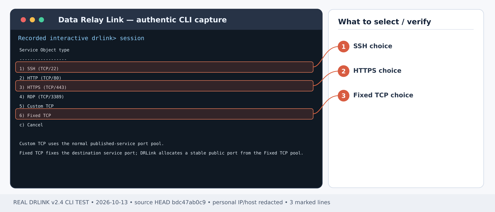
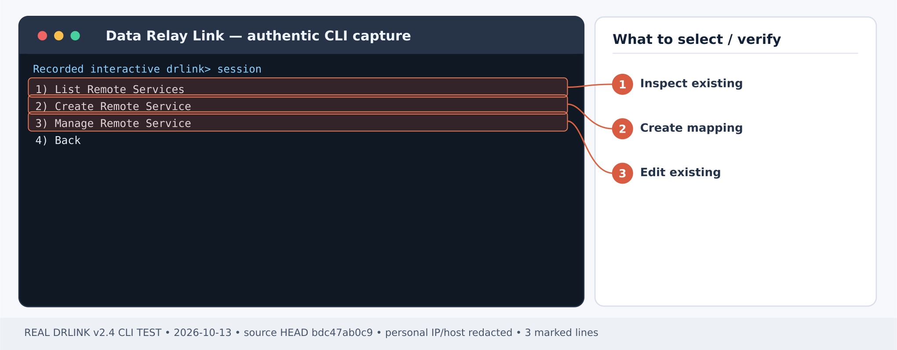
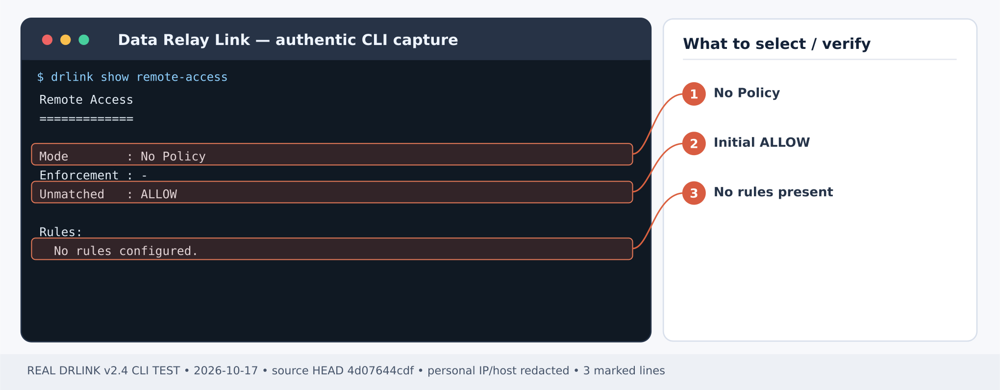

# 내부 HTTPS 관리자 화면을 외부에서 안전하게 열기

## 처음 설치부터 시작하기 — Remote Access

**시나리오별 최초 사용 순서:** [Server 설치](/ko/getting-started/server-installation) → 내부 HTTPS 대상에 접근 가능한 [Gateway Agent 등록](/ko/guides/enrollment) → 대상의 TLS 인증서·브라우저 호스트명 검증. 신규 Agent 등록에서 `Choose Remote Services`를 선택하면 HTTPS 서비스가 자동 생성됩니다. 해당 서비스를 수동 중복 생성하지 마세요. Remote Access는 초기 정책 없음 상태가 ALLOW이므로 공개 전에 [허용 출발지 WHITELIST](/ko/use-cases/office-allowlist)를 설정하고, 할당된 공개 포트만 방화벽에 열어 실제 브라우저 접근과 미승인 출발지 차단을 확인하세요.

1. [Server 설치](/ko/getting-started/server-installation)를 먼저 완료하고 [Direct/single443 모드](/ko/deployment/modes), [방화벽·NAT](/ko/deployment/firewall-nat)의 제어 연결과 실제 공개 서비스 포트를 허용합니다. 외부 방화벽은 제품이 자동 변경하지 않습니다.
2. **Server REPL에서 Managed Host를 등록**하고 생성된 Zero-Touch 명령을 대상 **Agent Host**에서 실행합니다. [등록 안내](/ko/guides/enrollment)를 따르세요. SSH only로 등록하면 Service Object, Remote Service, 공개 endpoint가 **자동 생성되므로 중복 생성하지 않습니다**. LAN gateway 또는 추가 Custom TCP 서비스는 필요에 맞게 관리 전용 등록 후 Server Object를 준비하고, 해당 Agent에서 새 Remote Service를 만듭니다.
3. **인바운드 ACL을 명시적으로 설정**합니다. Remote Access는 No Policy 또는 enforcement disabled일 때 **ALLOW ALL**입니다. 실제 외부 출발지 Network Object와 Managed Host·Service Object를 지정한 WHITELIST를 [사무실 IP 제한 실습](/ko/use-cases/office-allowlist)처럼 설정하고 허용·차단을 모두 확인합니다.
4. **Server 셸**에서 설치 상태를 확인한 뒤 아래 개별 시나리오를 진행합니다.

~~~bash
sudo drlink system version
sudo drlink show status
sudo drlink show managed-hosts
sudo drlink show remote-access
~~~

5. 실제 할당된 공개 endpoint를 이용하여 허용된 외부 PC에서 SSH/HTTPS/TCP를 연결하고, 미허용 출발지에서는 DENY되는지 감사 기록까지 확인합니다. 정책 ALLOW만으로 실통신 성공은 아닙니다.

<Note>Remote Access에는 대상 또는 LAN gateway의 Agent가 필요합니다. MCP AI 권한이나 Internet Access 정책은 인바운드 Remote Service를 대신 생성하지 않습니다.</Note>

**완성 결과:** 사설망 내부 방화벽/장비의 HTTPS 관리 포트만 외부의 승인된 지원 PC에서 접근하고, 다른 LAN 자원은 연결하지 않습니다.

예제: Agent가 접근 가능한 내부 관리 화면 **10.40.10.8:8443**.

## 1단계 — 내부 서비스와 TLS 확인

Agent/Gateway OS에서 내부 **10.40.10.8:8443** 연결이 실제로 되는지 확인하세요. 서비스는 사용자에게 보일 DNS 이름과 일치하는 정상 TLS 인증서를 제공해야 합니다. DRLink Remote Access는 **HTTPS TLS passthrough**이며 인증서를 대신 발급하거나 TLS를 종료하지 않습니다.

## 신규 Agent: Zero-Touch로 관리 화면 연결

Server에서 `set enrollment zero-touch` → **Linux** → 호스트 이름·설명 → **Choose Remote Services** → **Add HTTPS**를 선택합니다. Service ID는 `firewall-ui`, Target host는 **10.40.10.8**, Target port는 **8443**으로 입력하고 **Finish**합니다. 생성된 명령을 해당 LAN에 도달 가능한 게이트웨이에서 실행합니다.

필요한 Object와 Remote Service는 자동 구성됩니다. Agent에서 `show remote-services`와 실제 이름의 상세 조회로 endpoint를 확인한 뒤 **4단계**로 이동합니다. 아래 2~3단계는 기존 Agent에 서비스를 추가할 때만 사용합니다. 공개 전 필요한 출발지 제한을 준비하세요.

## 2단계 — 목적지와 포트 정의

*그림 1. 실제 Service Object 유형 선택: SSH는 1번, HTTPS는 3번, Fixed TCP는 6번입니다. 제품 CLI 출력 예시; 일부 주소·호스트는 가렸습니다.*

**Server REPL:**

~~~text
set network-object firewall-console type ip value 10.40.10.8
set service-object console-https type tcp port 8443
show network-object firewall-console
show service-object console-https
~~~

관리 화면은 민감하므로 가능하면 [사무실 IP 허용 정책](/ko/use-cases/office-allowlist)을 **먼저** 구성합니다.

## 3단계 — 필요한 Remote Service 하나만 생성

*그림 2. 소유 Agent Host에서 2번 Create Remote Service를 선택합니다. Server에서 원격 서비스를 직접 생성하는 메뉴가 아닙니다. 제품 CLI 출력 예시; 일부 주소·호스트는 가렸습니다.*

목적지 LAN에 도달 가능한 Agent를 [등록](/ko/guides/enrollment)한 뒤 **Agent REPL:**

~~~text
set remote-service firewall-ui destination firewall-console service console-https enabled
show remote-service firewall-ui
~~~

**확인:** 출력된 실제 공인 포트와 엔드포인트를 기록합니다.

## 4단계 — 브라우저/HTTPS로 접속 확인

외부 DNS 예제 **console.example.net**이 DRLink의 공인 주소를 가리키도록 관리자 측에서 설정합니다. 내부 애플리케이션 TLS 인증서에도 이 이름이 포함되어야 합니다.

~~~text
https://console.example.net:<예약된-공인-포트>/
~~~

DNS 테스트 시 URL 호스트명과 TLS 검증을 유지하려면 값 교체 후:

~~~bash
curl --resolve console.example.net:<reserved-public-port>:<drlink-public-ip> https://console.example.net:<reserved-public-port>/
~~~

**성공 기준:** 인증서 오류 없이 원래 장비의 로그인 화면이 열리고, 기존 장비 계정으로 로그인합니다. DRLink가 장비 관리 계정을 생성하지는 않습니다.

## 5단계 — 허용되지 않은 접속 차단 검증

*그림 3. Remote Access 규칙 생성 이전의 실제 출력: No Policy·Unmatched ALLOW입니다. 새 서비스를 공개할 때 출발지 제한을 별도로 설정해야 합니다. 제품 CLI 출력 예시; 일부 주소·호스트는 가렸습니다.*

**Server REPL:**

~~~text
show remote-access
show managed-host <relay-host> remote-services
system audit
~~~

별도 비허용 출발지에서 실제 접속을 시도하고 정책 **DENY** 기록을 확인합니다. **No Policy 상태는 ALLOW**이므로 포트만 공개하고 정책 제한 없이 운용하지 마세요.

## 문제 해결/철회

- **인증서 오류:** 앱/DNS/SNI/발급 대상 확인. TLS 검증을 끄는 것은 해결책이 아닙니다.
- **Timeout:** 외부 방화벽/NAT, Agent 연결, 내부 8443 리스너 검사
- **예상치 못한 ALLOW:** 모든 Remote Access Rule 확인. `set remote-access disabled`는 DENY가 아닌 **ALLOW ALL**입니다.
- **서비스 종료:** 소유 Agent에서 `unset remote-service firewall-ui` 실행 전 연결 중단을 검토합니다.

## 최신 동작 확인 — 2026-10-28

애플리케이션의 TLS와 로그인은 유지됩니다. 할당된 공개 엔드포인트에서 인증서 호스트명을 검증하고 인증서 검사를 끄지 마세요. 재연결 뒤 소유 Agent에서 synchronize하고 현재 Remote Service 세대까지 확인한 후 복구로 판단합니다.

[현재 CLI 전체 목록](/ko/drlink/cli-reference) · [MCP 호환성](/ko/reference/mcp-validation)
