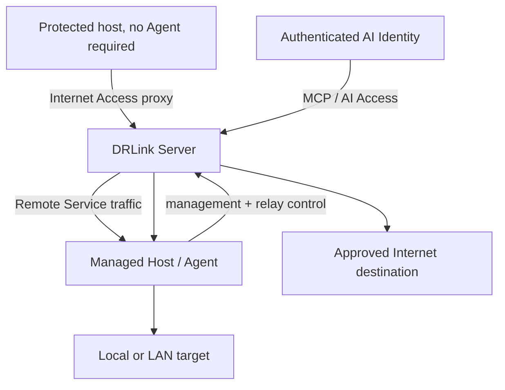

# Architecture

## Roles



## Server control plane

The Server owns enrollment, Managed Host inventory, Network/Service/Permission Objects and Groups, AI Identities, Access Policies, revisions, audit, backup/restore, and Server ConfigurationBundle.

## Agent plane

The Agent manages its local state and Remote Services. A Remote Service binds one destination to one Service Object and receives a stable DataRelay Link endpoint.

## Policy planes

| Plane | Supported modes | No policy | Enforcement disabled |
| --- | --- | --- | --- |
| Remote Access | BLACKLIST / WHITELIST | ALLOW | ALLOW ALL |
| Internet Access | WHITELIST only | DENY | DENY ALL |
| AI Access | WHITELIST only | DENY | DENY ALL |

WHITELIST denies unmatched requests. BLACKLIST is supported only by Remote Access: matching enabled Rules deny, unmatched requests allow. Rules have no ordering or per-rule action. Policy reset removes Mode/Rules and returns each plane to its own initial state. AI authentication remains required independently.

## Authoritative state

The product uses SQLite as authoritative Server state:

```text
/var/lib/drlink/drlink.db
```

Runtime configuration is generated from the control-plane state. JSON compatibility files from older releases are not an independent configuration source.

## Trust boundaries

Enrollment bootstrap credentials, persistent Agent management identity, Relay Engine transport credentials, and AI OAuth credentials are distinct. One credential must not be treated as another.

MCP is a server-side authenticated bridge. It does not bypass AI Access policy, Agent identity, or target OS permissions.

Server-self MCP is a separately authorized server:self target, independent of enrolled Agents. See [MCP setup](/guides/mcp-clients).
