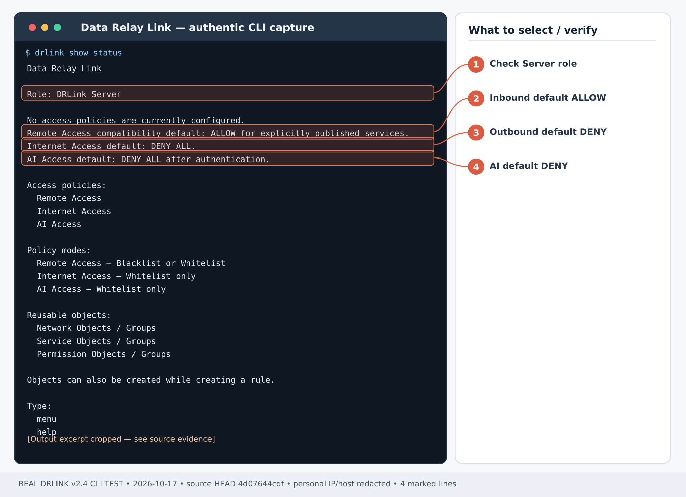
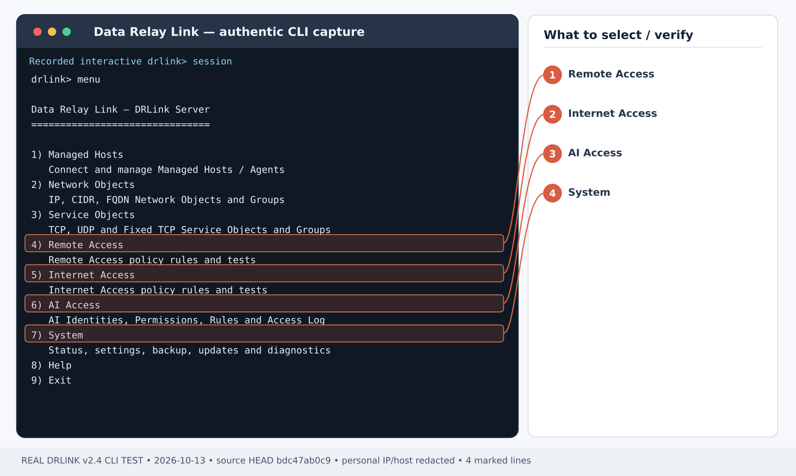

# Give an AI assistant full MCP capabilities — deliberately

**Outcome:** An approved Claude or ChatGPT AI Identity can exercise all seven Data Relay Link capabilities on a chosen Managed Host. An **optional, separate rule** enables Server-local commands, files, Git and jobs through `server:self`. Neither rule bypasses target OS permissions or the AI client's own approval controls.

<Warning>
  **Full access is a privileged operator choice, not the default.** `command-exec` runs with the product's configured OS execution account and is not confined by a file path glob or the initial `cwd`. Use a dedicated, verified operator identity on approved lab or admin hosts. Do not grant this role to general-purpose or untrusted AI identities.
</Warning>

*Figure 1. Real Server status before privileges are assigned; not an AI full-access execution result.*

*Figure 2. Real Server configuration menu; privilege changes still require explicit commands and verification.*

*Figure 1. Existing Server CLI guided menu; this is a menu illustration, not proof of a Full grant.*

*Figure 2. Actual Server security status capture; check effective policy after your own changes.*

## Step 1 — install and reach your Server

On a supported Linux Server, complete [Server installation](/getting-started/server-installation) and choose **single443** for public MCP. Configure DNS, a trusted public TLS certificate and the external firewall as in [MCP client setup](/guides/mcp-clients) and [Firewall & NAT](/deployment/firewall-nat). An ACME HTTP-01 deployment also needs TCP/80 during certificate issuance.

**Server shell:**

~~~bash
sudo drlink system version
sudo drlink show status
sudo drlink system diagnostics mcp
sudo drlink system certificate status
~~~

Verify that the Server is healthy, the public MCP endpoint is `https://mcp.example.net/mcp` (substitute your real hostname) and OAuth discovery is reachable. A working relay on TCP/443 in **direct** mode does **not** mean remote MCP is ready.

## Step 2 — enroll an approved Managed Host

Use an existing enrolled host or register one with [Managed Host enrollment](/guides/enrollment). For **management-only enrollment**, on the **Server REPL** run:

~~~text
set enrollment bulk
~~~

Choose **count 1** and leave the SSH username blank so no Remote Service is published merely for MCP. Run the generated, short-lived command on the **target machine**, not on the Server. Check the generated installer before execution.

**Server REPL:**

~~~text
show managed-hosts
show managed-host branch-a
~~~

Replace `branch-a` in the remaining steps with the actual enrolled Managed Host name. The Agent must be connected; no public SSH service, external SSH port or Remote Access ACL is required for Agent-based MCP.

## Step 3 — create a distinct authenticated AI Identity

**Server REPL:** Create `operator-ai` and configure OAuth as supported by the installed Server.

~~~text
set ai-identity operator-ai
system credential configure ai-identity operator-ai authentication oauth
show ai-identity operator-ai
~~~

Then register `https://mcp.example.net/mcp` in [Claude or ChatGPT](/guides/mcp-clients). Match the pending OAuth request to your real client and the intended identity, then run on the **Server shell**, replacing the placeholder:

~~~bash
sudo drlink system credential approve-oauth <PENDING-ID> operator-ai
~~~

OAuth authentication by itself is **not** permission to control every host. A first approved owner might already receive the `mcp-owner-full-access` rule for enrolled Managed Hosts; **inspect all effective rules** before adding or describing permissions. Prefer a separate non-owner identity when testing least privilege.

## Step 4 — grant all seven Managed Host permissions

**Server REPL:** The seven permissions are `host-info`, `process-read`, `file-read`, `file-write`, `file-upload`, `file-download` and `command-exec`.

~~~text
set permission-object operator-full permissions host-info,process-read,file-read,file-write,file-upload,file-download,command-exec
set ai-access operator-full-host mode whitelist source operator-ai destination branch-a permission operator-full paths '/*' enabled
set ai-access enabled
show permission-object operator-full
show ai-access operator-full-host
test ai-access source operator-ai destination branch-a permission command-exec
test ai-access source operator-ai destination branch-a permission file-read path /etc/hostname
~~~

Use the deliberately broad `/*` path scope **only** for an approved full-access identity. File operations still require a matching real path and OS access. `command-exec` can launch arbitrary commands with that execution account's authority: a path scope does **not** sandbox shell commands.

To authorize more Managed Hosts, add **explicit rules for each approved host** (or a carefully reviewed supported destination group); do not assume one host rule extends to all future enrollments.

## Step 5 — optional, separate full control of the Server

This step is **not** needed to control a Managed Host. To enable Server-local file operations, shell, Git and asynchronous jobs, add an explicit **server:self** rule for the same identity:

~~~text
set ai-access operator-full-server mode whitelist source operator-ai destination server:self permission operator-full paths '/*' enabled
show ai-access operator-full-server
test ai-access source operator-ai destination server:self permission command-exec
test ai-access source operator-ai destination server:self permission file-read path /etc/hostname
~~~

Only perform this step on a Server approved for AI command execution. The MCP `server_*` tools use that Server's configured OS execution account, not the Agent's account. The current directory is **not** a security sandbox. For a narrower Server-only example, use [Server files, Git and jobs](/use-cases/ai-server-control).

## Step 6 — prove real allowed and denied operations

In the actual OAuth-connected AI client, ask it to:

1. Call `list_hosts` and `get_system_info` for the chosen host, then `list_processes`.
2. Call `exec` on **branch-a** with a harmless command such as `id`. Read `execution_user`, exit state and output; do not assume root.
3. In a disposable approved directory, verify `read_file`, `write_file`, `upload_file` and `download_file` only where useful and OS permissions allow. Remove only your own test file.
4. **If Step 5 was enabled**, call `get_server`, `server_exec` with `id` and `server_read_file` against the Server. Test Server Git/jobs only in a disposable workspace.
5. Try the same `exec` against a **different, unapproved Managed Host**, using an endpoint that actually exists. Expect **DENY** unless another rule permits it.

**Server REPL:**

~~~text
show ai-access
show ai-access-log identity operator-ai
~~~

A CLI `test ai-access` ALLOW is a **policy prediction**; only the actual MCP tool receipt proves authentication, Agent connectivity, OS access and end-to-end execution. Record any AI-client-side approval or denial separately.

## Step 7 — review, narrow or retire the grant

Review the full effective rule set and remove **only** tutorial rules that are no longer needed:

~~~text
show ai-access
unset ai-access operator-full-server
unset ai-access operator-full-host
show ai-access
~~~

The Server-self Rule may not exist if Step 5 was skipped; omit that `unset` in that case. Remove the `operator-full` Permission Object or revoke `operator-ai` only after confirming no other workflows rely on them. Do not use an AI Access reset to manage unrelated identities.

For minimum access instead, follow [Read-only MCP](/use-cases/ai-readonly) or [AI Access policy](/guides/ai-access). For inbound user SSH permissions use [Remote Access](/guides/remote-access); for inside-to-outside Internet access use [Internet Access](/guides/internet-access). These are **different policy planes**.
