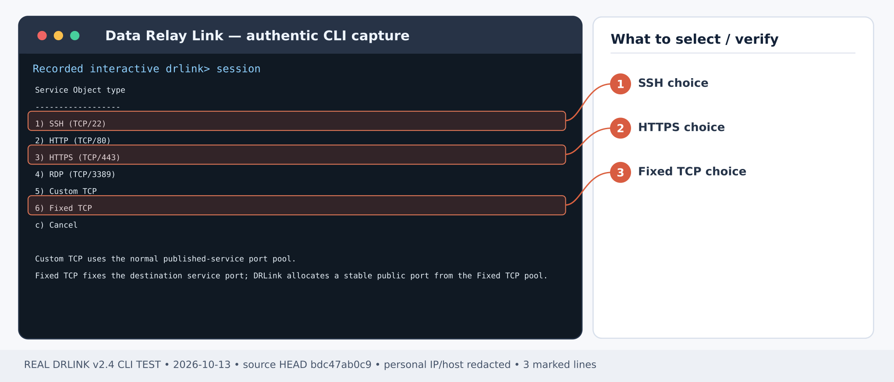
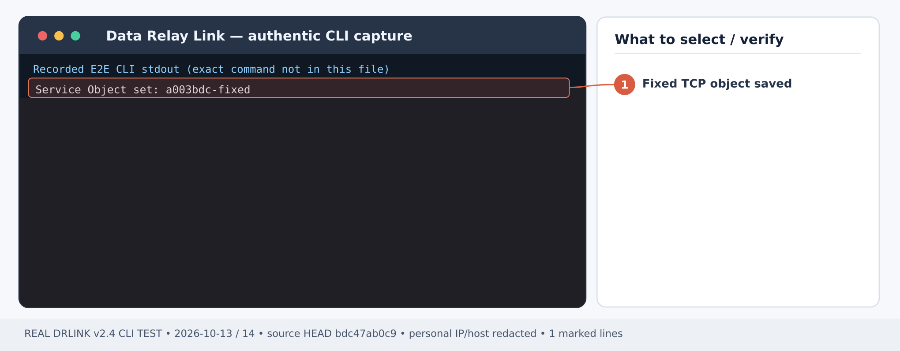
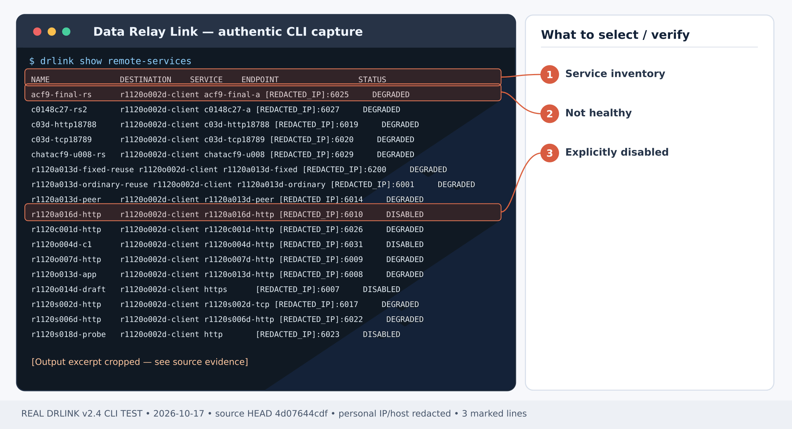

# Publish a legacy database via Fixed TCP Remote Service

## First-time setup — Remote Access

**Scenario-specific first-use order:** Install the [Server](/getting-started/server-installation), verify that its **Fixed TCP public endpoint pool** is configured and reachable through [NAT/firewall](/deployment/firewall-nat), and [enroll a LAN-reachable Agent](/guides/enrollment). Ensure the target DB listener and DB authentication/TLS work from that gateway. The steps below prepare a **new additional** Fixed TCP service on an enrolled Agent; do not duplicate any equivalent service already generated during enrollment. Restrict the allowed DBA public source via [Remote Access WHITELIST](/guides/remote-access) before publishing, then test with an actual database client.

1. **Install the Linux Server** using [Server installation](/getting-started/server-installation). Choose [Direct or single443](/deployment/modes) for your network; configure DNS, public relay/control access and the actual published endpoint pool in [Firewall & NAT](/deployment/firewall-nat). The product does not edit external firewalls.
2. **Enroll the target as a Managed Host** from the **Server REPL** using the [enrollment guide](/guides/enrollment). Run the generated one-time bootstrap on the *target Agent Host*, not on the Server. For a first SSH-only enrollment, select **SSH only** in the Zero-Touch wizard; it automatically creates the Service Object, Remote Service and endpoint. **Do not recreate those objects**. For a LAN gateway or a new custom service, use management-only enrollment as appropriate, then define the Server Objects and add the new Remote Service on its owning Agent.
3. **Apply the inbound Access Control policy deliberately.** Without a configured Remote Access policy, access is ALLOW; disabled enforcement also means ALLOW ALL. For restricted access, set a source Network Object and an explicit WHITELIST Rule for the actual Managed Host and Service Object as shown in [Office-only ACL](/use-cases/office-allowlist) *before relying on the endpoint*. Test an authorized and an unauthorized source.
4. **Check both roles**, then follow the scenario steps below. Server shell:

~~~bash
sudo drlink system version
sudo drlink show status
sudo drlink show managed-hosts
sudo drlink show remote-access
~~~

5. **Test the real application** from the permitted outside workstation using the actual allocated endpoint. A policy-test ALLOW is not a real SSH/HTTPS/TCP connection. Verify the negative case and audit, and keep target OS authentication and service TLS in place.

<Note>For remote connectivity, an Agent is required on the target or LAN gateway. MCP permission and Internet Access policy are separate and do not create an inbound Remote Service.</Note>

**Outcome:** An external database support client reaches one internal TCP database listener, through a stable DRLink Remote Access endpoint and a restricted source policy.

**Example:** approved DBA public IP 203.0.113.10 → Server → branch gateway Agent → Oracle-like listener at 10.50.1.20:1521. Use your actual protocol and database client.

<Note>
  This is a **Fixed TCP Remote Service** (inbound Remote Access), not the separate outbound Internet Access fixed-listener feature. It does not configure HTTP CONNECT, a transparent proxy or a full VPN.
</Note>

## Step 1 — verify target network and credentials

From the gateway Agent OS, verify that **10.50.1.20:1521** is reachable. Keep database TLS, DB accounts, encryption and authentication configured on the destination. DRLink does not supply database credentials.

## Step 2 — describe destination and Fixed TCP port

*Figure 1. Service Object type choices: 1 SSH/TCP 22, 3 HTTPS/TCP 443, or 6 Fixed TCP as needed. CLI output example; sensitive addresses and hostnames are masked.*

*Figure 2. Real CLI confirmation that a Fixed TCP Service Object was saved; endpoint/DB connectivity must be tested separately. CLI output example; sensitive addresses and hostnames are masked.*

**Server REPL:**

~~~text
set network-object branch-db type ip value 10.50.1.20
set network-object dba-public type ip value 203.0.113.10
set service-object oracle-db type fixed-tcp port 1521
show service-object oracle-db
show managed-hosts
~~~

Verify the enrolled gateway's Managed Host name (example **branch-gateway**). A Fixed TCP Service Object uses a different endpoint pool from regular TCP; do not change a running Remote Service across those pool classes in place.

## Step 3 — restrict access before publishing

**Server REPL:**

~~~text
set remote-access dba-to-db mode whitelist source dba-public destination branch-gateway service oracle-db enabled
set remote-access enabled
test remote-access source dba-public destination branch-gateway service oracle-db
show remote-access
~~~

Expected: **ALLOW** for the approved source. Review all matching Rules and the `show remote-access` state for unintended sources.

## Step 4 — create the service on the gateway Agent

*Figure 3. Captured Remote Services inventory: distinguish DEGRADED from DISABLED; a listed endpoint is not proof of live traffic. CLI output example; sensitive addresses and hostnames are masked.*

**Gateway Agent REPL:**

~~~text
set remote-service branch-oracle destination branch-db service oracle-db enabled
show remote-service branch-oracle
~~~

Record the public endpoint. Expect **HEALTHY** only when the currently connected relay/runtime and destination can be verified.

## Step 5 — verify the database workflow

From the approved external DBA workstation:

~~~bash
nc -vz <drlink-public-host> <allocated-fixed-tcp-public-port>
~~~

A successful TCP probe only proves a socket handshake. Complete the actual protocol-specific database login/query using your vendor's database client pointed at the public endpoint. Confirm a rejected connection from a different public source and correlate the policy audit.

## Recovery and teardown

If connection fails, check Server policy and the gateway's `system diagnostics`, the target listener and external port mapping. The host's database encryption and account controls remain mandatory. Retire only this service with `unset remote-service branch-oracle` on the owning gateway Agent after reviewing DB-client interruptions; do not retire the whole Managed Host.

## Current behavior check — 2026-10-28

Fixed TCP remains a Service Object subtype using its separate Server endpoint pool. An existing Remote Service cannot switch across standard TCP/Fixed TCP pools in place. Read the allocated endpoint from show remote-service branch-oracle, rather than assuming the public port equals the database target port.

[Current CLI inventory](/drlink/cli-reference) · [MCP compatibility](/reference/mcp-validation)
