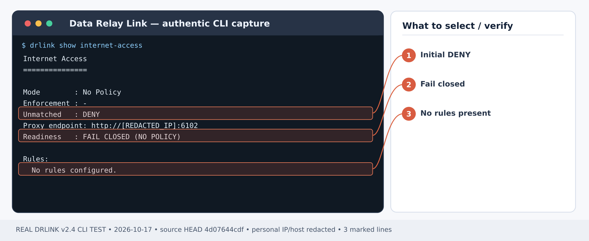
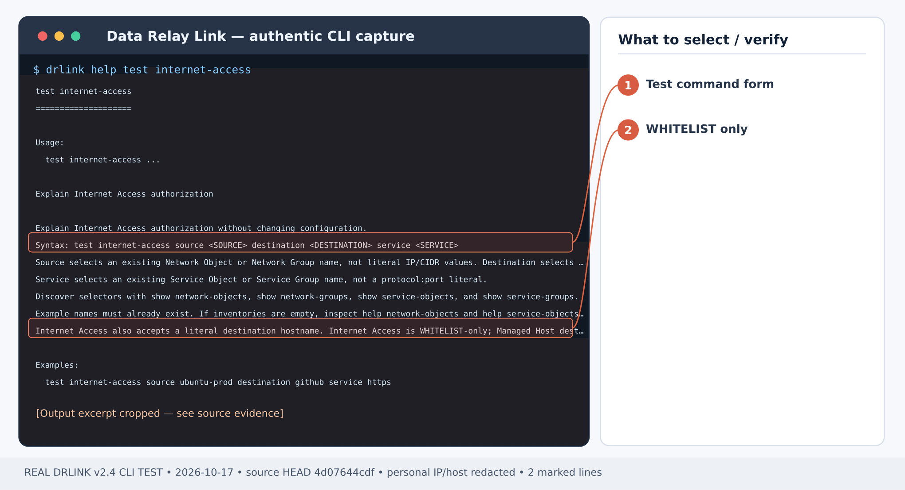
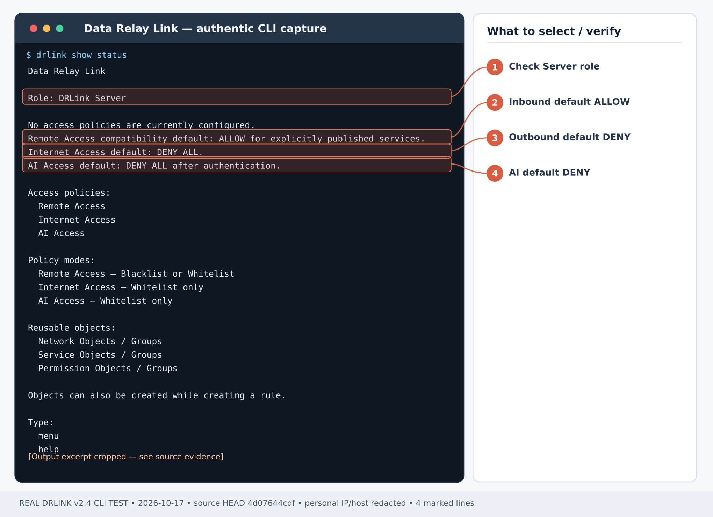

# Use GitHub Git and API through restricted Internet Access

## First-time setup — controlled outbound access

**Scenario-specific first-use order:** Install the [Server](/getting-started/server-installation), confirm the Internet Access proxy listener is reachable from the protected host and egress DNS/Internet reachability exists **from the Server**. No Agent is needed for ordinary proxy-aware Git/curl. Allow only the proxy's external firewall port from the source network, register the source IP/CIDR visible **after NAT**, and define exact GitHub/API-related FQDN+TCP port objects under [Internet Access WHITELIST](/guides/internet-access). Git operations may contact additional redirect/content hosts; inspect actual request logs and approve each needed destination individually. Confirm both authorized real Git/curl and denied unrelated traffic.

1. Install and verify the **Linux Server** with [Server installation](/getting-started/server-installation). Check the Internet Access listener's real interface/port in diagnostics and configure [firewall/NAT](/deployment/firewall-nat) so the **protected host → Server proxy endpoint** is reachable. Keep direct Internet egress blocked by your own network firewall.
2. **No DRLink Agent, Managed Host enrollment or Remote Service is required on the protected HTTP(S) application host.** The Server uses a source IP/CIDR Network Object (the address **seen by the proxy after NAT**), destination FQDN Network Objects and TCP Service Objects for the requested ports.
3. Create exact [Internet Access WHITELIST rules](/guides/internet-access), enable enforcement and test allowed and denied selectors. Internet Access is **DENY by default**, including when enforcement is disabled; it does not permit unrestricted Internet use.
4. On the protected host, configure the application **HTTP_PROXY/HTTPS_PROXY** or application-specific proxy option for your actual Server proxy endpoint. Verify real HTTPS CONNECT or HTTP requests, the unapproved destination DENY and Server audit. A successful direct Internet call or policy-test alone does not qualify.

**Server shell baseline:**

~~~bash
sudo drlink system version
sudo drlink show status
sudo drlink show internet-access
sudo drlink system diagnostics
~~~

**Outcome:** A build or administration host can fetch Git metadata and call a required HTTPS API via DRLink, but cannot browse unrelated destinations through the proxy.

**Example:** protected host 10.20.30.16 → proxy 10.20.30.5:6080 → **github.com:443** and **api.github.com:443** only. Adapt to your application and observed NAT source.

## Step 1 — validate the actual proxy listener

*Figure 1. Internet Access before policy creation: No Policy, Unmatched DENY, FAIL CLOSED. This is NOT an approved-traffic result. CLI output example; sensitive addresses and hostnames are masked.*

**Server REPL:**

~~~text
show internet-access
system diagnostics
~~~

Take the listener address/port from current Server diagnostics, not a legacy config file. Configure the external firewall to accept only approved protected-host sources.

## Step 2 — define source and HTTPS destinations

**Server REPL:**

~~~text
set network-object git-source type ip value 10.20.30.16
set network-object github-site type fqdn value github.com
set network-object github-api type fqdn value api.github.com
set service-object https443 type tcp port 443
~~~

## Step 3 — create the WHITELIST

*Figure 2. Real command help: test internet-access selects existing Objects/Groups and validates authorization only. CLI output example; sensitive addresses and hostnames are masked.*

**Server REPL:**

~~~text
set internet-access git-https mode whitelist source git-source destination github-site service https443 enabled
set internet-access api-https source git-source destination github-api service https443 enabled
set internet-access enabled
show internet-access
test internet-access source git-source destination github-site service https443
test internet-access source git-source destination github-api service https443
~~~

Expected: both exact hostname selectors **ALLOW**. There must be no blanket **ANY** or generic wildcard rule.

## Step 4 — run real proxy-aware applications

**Protected host shell**, in a subshell so proxy settings do not leak into the operator's login session:

~~~bash
(
  PROXY_URL="http://10.20.30.5:6080"
  export http_proxy="$PROXY_URL" https_proxy="$PROXY_URL"
  export HTTP_PROXY="$PROXY_URL" HTTPS_PROXY="$PROXY_URL"
  bypass="${no_proxy:-}"
  if [ -n "${NO_PROXY:-}" ]; then bypass="${bypass:+${bypass},}${NO_PROXY}"; fi
  bypass="${bypass:+${bypass},}127.0.0.1,localhost"
  export no_proxy="$bypass" NO_PROXY="$bypass"

  no_proxy= NO_PROXY= git -c http.proxy="$PROXY_URL" ls-remote https://github.com/git/git.git HEAD
  curl --noproxy '' --proxy "$PROXY_URL" --head --show-error https://api.github.com/
  curl --noproxy '' --proxy "$PROXY_URL" --head --show-error https://example.org/
)
~~~

Expected: Git returns a commit SHA for **HEAD**, the API request travels through the proxy (the API response may depend on upstream rate limits), and the third request receives an explicit DRLink policy **DENY**. If the inherited **no_proxy/NO_PROXY** includes those public hostnames, remove such bypasses **for this scoped test only**, rather than declaring that direct traffic was relayed.

## Step 5 — confirm audit and real routing

*Figure 3. Captured Server status before policy setup: Remote Access default ALLOW; Internet Access and AI Access default DENY. CLI output example; sensitive addresses and hostnames are masked.*

**Server REPL:**

~~~text
show internet-access
system audit
system diagnostics
~~~

Verify source IP, destination hostname/port and matched policy result. The test command is a policy simulation; the Git/curl commands provide application traffic. If clone operations later access **codeload.github.com** or other domains, approve them one by one according to actual evidence rather than widening the allowlist.

## Recovery

- **DENY for approved Git:** check proxy-visible source, actual URL authority and exact policy selectors.
- **TLS trust error:** repair destination trust/certificates or a documented application proxy trust chain; DRLink does not decrypt the target TLS.
- **Proxy timeout:** check the listener and external firewall separately from a policy denial.
- **Unwanted broad access:** inspect all enabled Internet Access rules and Network/Service Group membership; disable the offending Rule or change it through reviewed policy mutation. Internet Access disabled enforcement is **DENY ALL**.

## Current behavior check — 2026-10-28

Use explicit proxy routing in the application test and clear public-host no_proxy bypasses only for that invocation. A Managed Host source selector matches only a provable active proxy-visible peer IP; behind NAT use the observed IP/CIDR. No UDP or private/metadata destination bypass is implied by an FQDN allowlist.

[Current CLI inventory](/drlink/cli-reference) · [MCP compatibility](/reference/mcp-validation)
