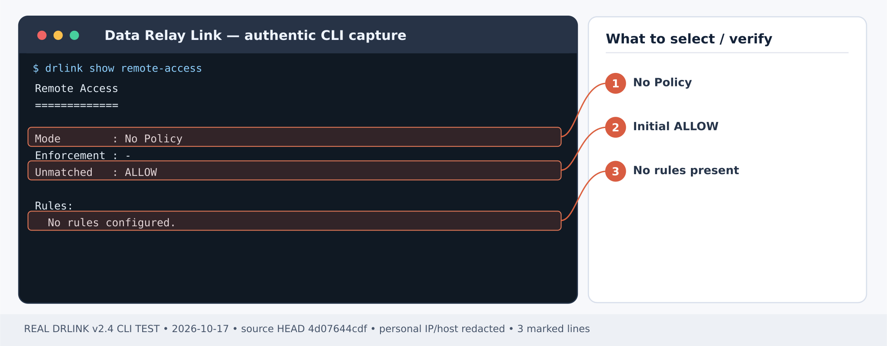
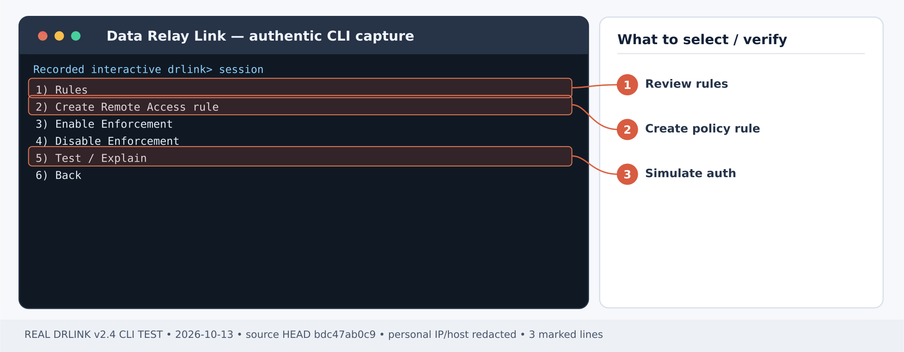
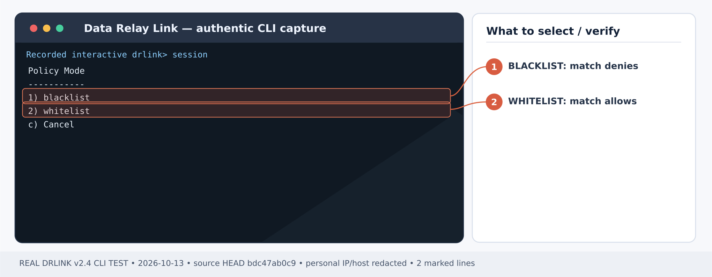
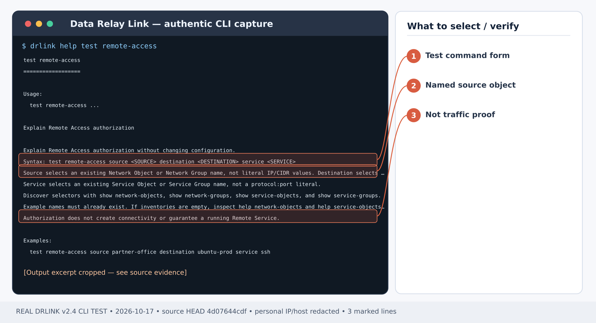

# Limit remote support to one approved office IP

## Before Step 1 — new installation checklist

**First-time order:** Install the [Server](/getting-started/server-installation), [enroll the SSH Agent](/guides/enrollment), and discover its **actual** Remote Service / Service Object from the Agent; Zero-Touch SSH-only has already created those objects. Determine the office's **public NAT egress IP** and prepare a second real outside test source. The starting Remote Access no-policy state is **ALLOW**; do not disable policy enforcement or reset it to test a lockdown. Review other existing rules before adding the WHITELIST, and validate with actual SSH plus audit—not only a policy-test result.

## First-time setup — Remote Access

**Scenario-specific first-use order:** **First-time order:** Install the [Server](/getting-started/server-installation), [enroll the SSH Agent](/guides/enrollment), and discover its **actual** Remote Service / Service Object from the Agent; Zero-Touch SSH-only has already created those objects. Determine the office's **public NAT egress IP** and prepare a second real outside test source. The starting Remote Access no-policy state is **ALLOW**; do not disable policy enforcement or reset it to test a lockdown. Review other existing rules before adding the WHITELIST, and validate with actual SSH plus audit—not only a policy-test result.

1. **Install the Linux Server** using [Server installation](/getting-started/server-installation). Choose [Direct or single443](/deployment/modes) for your network; configure DNS, public relay/control access and the actual published endpoint pool in [Firewall & NAT](/deployment/firewall-nat). The product does not edit external firewalls.
2. **Enroll the target as a Managed Host** from the **Server REPL** using the [enrollment guide](/guides/enrollment). Run the generated one-time bootstrap on the *target Agent Host*, not on the Server. For a first SSH-only enrollment, select **SSH only** in the Zero-Touch wizard; it automatically creates the Service Object, Remote Service and endpoint. **Do not recreate those objects**. For a LAN gateway or a new custom service, use management-only enrollment as appropriate, then define the Server Objects and add the new Remote Service on its owning Agent.
3. **Apply the inbound Access Control policy deliberately.** Without a configured Remote Access policy, access is ALLOW; disabled enforcement also means ALLOW ALL. For restricted access, set a source Network Object and an explicit WHITELIST Rule for the actual Managed Host and Service Object as shown in [Office-only ACL](/use-cases/office-allowlist) *before relying on the endpoint*. Test an authorized and an unauthorized source.
4. **Check both roles**, then follow the scenario steps below. Server shell:

~~~bash
sudo drlink system version
sudo drlink show status
sudo drlink show managed-hosts
sudo drlink show remote-access
~~~

5. **Test the real application** from the permitted outside workstation using the actual allocated endpoint. A policy-test ALLOW is not a real SSH/HTTPS/TCP connection. Verify the negative case and audit, and keep target OS authentication and service TLS in place.

<Note>For remote connectivity, an Agent is required on the target or LAN gateway. MCP permission and Internet Access policy are separate and do not create an inbound Remote Service.</Note>

**Outcome:** Only the office public source IP may access a specific Agent-owned SSH Remote Service. Other public sources receive a Remote Access policy denial.

**Example:** office egress IP 203.0.113.10 → Server → Managed Host **branch-a**, service object **ssh**. Substitute real public addresses.

<Warning>
  Without any configured Remote Access policy, v2.4 effective Remote Access is **ALLOW**. **Disabling** Remote Access enforcement also means **ALLOW ALL**. Do not use disabling enforcement as a lockdown or casually reset/delete the only WHITELIST rule.
</Warning>

## Step 1 — identify the actual source and existing rules

*Figure 1. Remote Access before any rules: No Policy, unmatched ALLOW. A new published service is not automatically source-restricted. CLI output example; sensitive addresses and hostnames are masked.*

**Server REPL:**

~~~text
show managed-hosts
show service-objects
show remote-access
system backup
~~~

The Server must already have **branch-a** enrolled with a valid SSH Service Object. Capture the current policy and the backup archive path. Determine the office's **public/NAT egress IP as seen at the Server**; a workstation's internal private IP may not be the observed source.

## Step 2 — create explicit source selectors

**Server REPL:**

~~~text
set network-object office-public type ip value 203.0.113.10
set network-object unapproved-test type ip value 198.51.100.21
show network-object office-public
~~~

Use a legitimate alternate public source for the negative test; the documentation addresses above are examples.

## Step 3 — create the WHITELIST

*Figure 2. Remote Access guided menu: choose 2 Create rule, then 5 Test / Explain to validate. CLI output example; sensitive addresses and hostnames are masked.*

*Figure 3. Policy Mode selection: use 2 whitelist to ALLOW matched sources; 1 blacklist has different behavior. CLI output example; sensitive addresses and hostnames are masked.*

**Server REPL:**

~~~text
set remote-access office-ssh mode whitelist source office-public destination branch-a service ssh enabled
set remote-access enabled
show remote-access
show remote-access office-ssh
~~~

Review all pre-existing enabled Rules. WHITELIST entries may jointly authorize more sources than this single Rule. Rule changes may request confirmation based on the calculated security impact.

## Step 4 — test policy without creating connectivity

*Figure 4. Real command help: test remote-access requires named source, destination and service selectors. CLI output example; sensitive addresses and hostnames are masked.*

**Server REPL:**

~~~text
test remote-access source office-public destination branch-a service ssh
test remote-access source unapproved-test destination branch-a service ssh
~~~

Expected: **ALLOW** for the office, **DENY** for the unapproved source *if no other matching Rule exists*. The test is read-only and does not prove an SSH endpoint works.

## Step 5 — test real traffic from both networks

Use the reserved SSH public port printed by `show remote-service` on the Agent. From the actual office network:

~~~bash
ssh -p <reserved-public-port> <actual-os-user>@<drlink-public-host>
~~~

Repeat from an independently unapproved source. Confirm an explicit policy DENY / relevant audit record, not only a timeout or a separate firewall block. External firewall restrictions may additionally prevent traffic from reaching DRLink.

## Recovery and safety

If the office cannot reach the service, verify the NAT-visible office IP, Service Object name, target Managed Host, tunnel health and matched Rules with `test remote-access` / `system audit`. To change access safely, edit or replace the Rule under a maintenance plan. `unset remote-access policy` resets to default ALLOW; `set remote-access disabled` is also ALLOW ALL. Do not use either to repair a failed restriction unless a deliberately approved broad-access change is intended.

## Current behavior check — 2026-10-28

Inspect every enabled Rule and referenced Group before the negative test. Remote Access disabled enforcement and full policy reset open access (ALLOW ALL/initial ALLOW); they are not safe ways to prove denial. Group policy tests require every expanded combination to allow before reporting aggregate ALLOW.

[Current CLI inventory](/drlink/cli-reference) · [MCP compatibility](/reference/mcp-validation)
