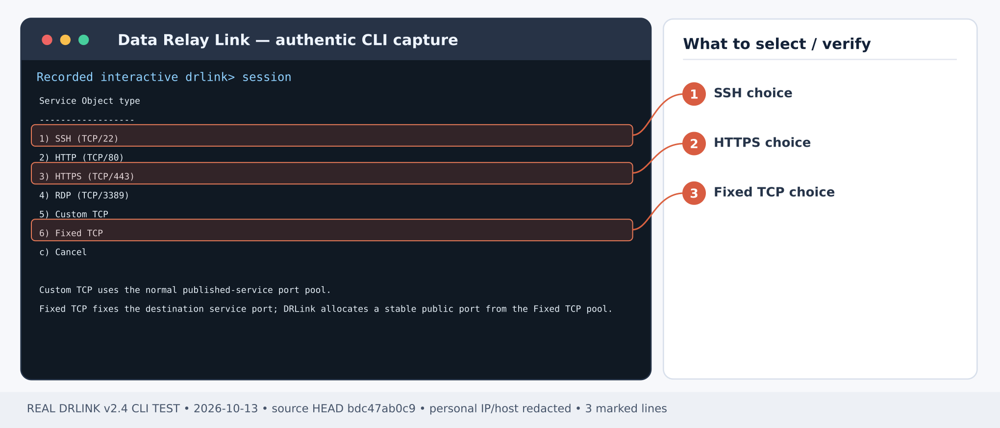
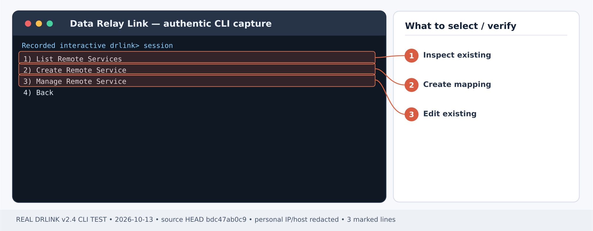
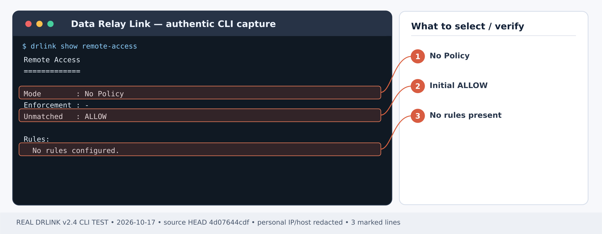

# Reach a private HTTPS administration console

## Before Step 1 — new installation checklist

**First-time order:** Install the [Server](/getting-started/server-installation) and [enroll a gateway Agent](/guides/enrollment) that can reach the actual private HTTPS origin. Check backend certificate and browser hostname validation independently of DRLink. For a new Agent, selecting `Choose Remote Services` automatically creates its selected HTTPS service; do **not** repeat the manual steps for the same service. Apply a source-specific [Remote Access WHITELIST](/use-cases/office-allowlist) **before** publication because the initial no-policy state is ALLOW. Open only the allocated public endpoint in external NAT/firewalls, then verify both authorized and unapproved origins.

## First-time setup — Remote Access

**Scenario-specific first-use order:** **First-time order:** Install the [Server](/getting-started/server-installation) and [enroll a gateway Agent](/guides/enrollment) that can reach the actual private HTTPS origin. Check backend certificate and browser hostname validation independently of DRLink. For a new Agent, selecting `Choose Remote Services` automatically creates its selected HTTPS service; do **not** repeat the manual steps for the same service. Apply a source-specific [Remote Access WHITELIST](/use-cases/office-allowlist) **before** publication because the initial no-policy state is ALLOW. Open only the allocated public endpoint in external NAT/firewalls, then verify both authorized and unapproved origins.

1. **Install the Linux Server** using [Server installation](/getting-started/server-installation). Choose [Direct or single443](/deployment/modes) for your network; configure DNS, public relay/control access and the actual published endpoint pool in [Firewall & NAT](/deployment/firewall-nat). The product does not edit external firewalls.
2. **Enroll the target as a Managed Host** from the **Server REPL** using the [enrollment guide](/guides/enrollment). Run the generated one-time bootstrap on the *target Agent Host*, not on the Server. For a first SSH-only enrollment, select **SSH only** in the Zero-Touch wizard; it automatically creates the Service Object, Remote Service and endpoint. **Do not recreate those objects**. For a LAN gateway or a new custom service, use management-only enrollment as appropriate, then define the Server Objects and add the new Remote Service on its owning Agent.
3. **Apply the inbound Access Control policy deliberately.** Without a configured Remote Access policy, access is ALLOW; disabled enforcement also means ALLOW ALL. For restricted access, set a source Network Object and an explicit WHITELIST Rule for the actual Managed Host and Service Object as shown in [Office-only ACL](/use-cases/office-allowlist) *before relying on the endpoint*. Test an authorized and an unauthorized source.
4. **Check both roles**, then follow the scenario steps below. Server shell:

~~~bash
sudo drlink system version
sudo drlink show status
sudo drlink show managed-hosts
sudo drlink show remote-access
~~~

5. **Test the real application** from the permitted outside workstation using the actual allocated endpoint. A policy-test ALLOW is not a real SSH/HTTPS/TCP connection. Verify the negative case and audit, and keep target OS authentication and service TLS in place.

<Note>For remote connectivity, an Agent is required on the target or LAN gateway. MCP permission and Internet Access policy are separate and do not create an inbound Remote Service.</Note>

**Outcome:** A support workstation securely reaches one appliance's HTTPS admin UI; you do not expose the entire appliance LAN.

**Example:** Agent on a reachable LAN host → firewall console 10.40.10.8:8443 → externally reserved DRLink TCP port.

## Step 1 — confirm the existing application

On the Agent/gateway OS, establish that **10.40.10.8:8443** is reachable and the admin application has a trusted certificate for the name end users will use. DRLink Remote Access uses **TLS passthrough**, not TLS termination. A certificate-name mismatch is a deployment problem, not a reason to disable verification.

## New Agent: configure the console with Zero-Touch

On the Server run `set enrollment zero-touch`, select **Linux**, name/describe the host, then **Choose Remote Services → Add HTTPS**. Enter Service ID `firewall-ui`, Target host **10.40.10.8**, Target port **8443**, then **Finish**. Run the generated command on the gateway that can reach that LAN.

The required Objects and Remote Service are automatic. Inspect `show remote-services` and the actual service detail on the Agent, then continue at **Step 4**. Steps 2–3 below are only for additional services on an existing Agent. Prepare required source restrictions before publishing.

## Step 2 — register the destination and service

*Figure 1. Service Object type choices: 1 SSH/TCP 22, 3 HTTPS/TCP 443, or 6 Fixed TCP as needed. CLI output example; sensitive addresses and hostnames are masked.*

**Server REPL:**

~~~text
set network-object firewall-console type ip value 10.40.10.8
set service-object console-https type tcp port 8443
show network-object firewall-console
show service-object console-https
~~~

Prefer setting the required Remote Access WHITELIST **before** publishing this sensitive UI. See [office-only allowlist](/use-cases/office-allowlist).

## Step 3 — publish only this port

*Figure 2. On the owning Agent Host select 2 Create Remote Service; this does not create the service on the Server. CLI output example; sensitive addresses and hostnames are masked.*

After [enrolling an Agent](/guides/enrollment) that can reach the target LAN IP, use the **Agent REPL**:

~~~text
set remote-service firewall-ui destination firewall-console service console-https enabled
show remote-service firewall-ui
~~~

Record the reserved public endpoint shown by the CLI.

## Step 4 — test from an authorized workstation

Configure a DNS name such as **console.example.net** to reach the DRLink public address. The backend HTTPS certificate must match **console.example.net** (or a separately verified name that the application actually presents). Access:

~~~text
https://console.example.net:<reserved-public-port>/
~~~

For a DNS test that preserves both the URL hostname and TLS verification, replace placeholders and use:

~~~bash
curl --resolve console.example.net:<reserved-public-port>:<drlink-public-ip> https://console.example.net:<reserved-public-port>/
~~~

Expected: the appliance login page over validated TLS, not a DRLink management login. Authenticate using the application's own identity mechanism.

## Step 5 — verify restricted access

*Figure 3. Remote Access before any rules: No Policy, unmatched ALLOW. A new published service is not automatically source-restricted. CLI output example; sensitive addresses and hostnames are masked.*

**Server REPL:**

~~~text
show remote-access
show managed-host <relay-host> remote-services
system audit
~~~

From a second, unapproved source, test access and confirm the **policy denial**, not merely a network timeout. If Remote Access has **no policy**, it defaults to **ALLOW**: publishing alone is not sufficient access restriction.

## Recovery

- **Certificate error:** correct DNS/certificate/SNI on the application, not a proxy rewrite; never turn off TLS verification to pass a test.
- **Browser timeout:** check external firewall, reserved port, Agent connectivity and target 10.40.10.8:8443.
- **Unexpected ALLOW:** inspect all matching Remote Access rules and their effective mode; `set remote-access disabled` is **ALLOW ALL**, not a safe emergency deny.
- **Retire console:** remove **firewall-ui** on the owning Agent after impact review, leaving unrelated LAN services untouched.

## Current behavior check — 2026-10-28

The application keeps its own TLS and login. Verify its certificate hostname at the allocated public endpoint without skipping certificate checks. After a reconnect, synchronize on the owning Agent and check the current Remote Service generation before declaring recovery.

[Current CLI inventory](/drlink/cli-reference) · [MCP compatibility](/reference/mcp-validation)
