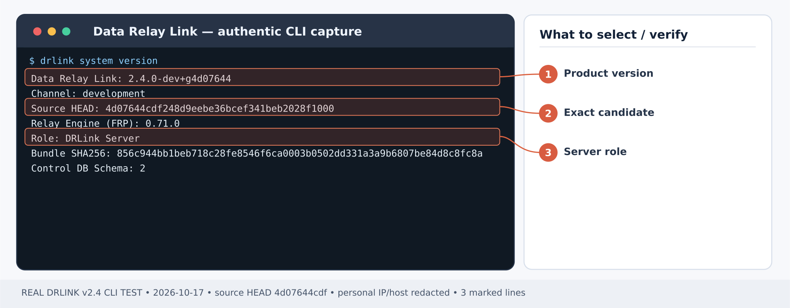
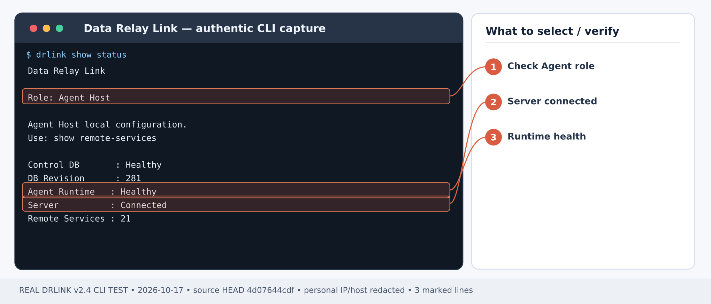
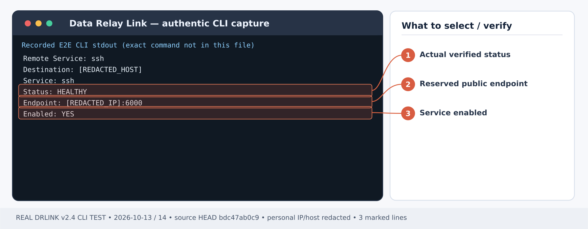
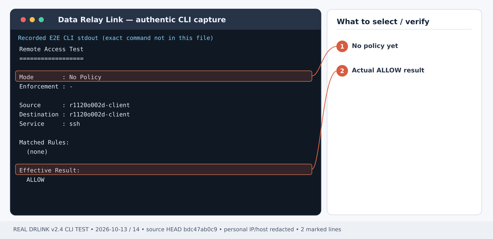

# Remote SSH to a machine behind NAT

## Before Step 1 — new installation checklist

**First-time order:** Install the [Server](/getting-started/server-installation), choose a [deployment mode](/deployment/modes), and open the applicable [firewall/NAT paths](/deployment/firewall-nat). Verify `sudo drlink show status` reports Server. Check the target SSH listener and outbound Agent→Server path. Apply a [Remote Access WHITELIST](/use-cases/office-allowlist) **before** exposing SSH when the source must be restricted; without a Remote Access policy, inbound access defaults to ALLOW. Create an SSH-only Zero-Touch enrollment; it **automatically creates** the Service Object, Remote Service and endpoint, so do not create them again. Test both an authorized and an unauthorized external source after enrollment.

## First-time setup — Remote Access

**Scenario-specific first-use order:** **First-time order:** Install the [Server](/getting-started/server-installation), choose a [deployment mode](/deployment/modes), and open the applicable [firewall/NAT paths](/deployment/firewall-nat). Verify `sudo drlink show status` reports Server. Check the target SSH listener and outbound Agent→Server path. Apply a [Remote Access WHITELIST](/use-cases/office-allowlist) **before** exposing SSH when the source must be restricted; without a Remote Access policy, inbound access defaults to ALLOW. Create an SSH-only Zero-Touch enrollment; it **automatically creates** the Service Object, Remote Service and endpoint, so do not create them again. Test both an authorized and an unauthorized external source after enrollment.

1. **Install the Linux Server** using [Server installation](/getting-started/server-installation). Choose [Direct or single443](/deployment/modes) for your network; configure DNS, public relay/control access and the actual published endpoint pool in [Firewall & NAT](/deployment/firewall-nat). The product does not edit external firewalls.
2. **Enroll the target as a Managed Host** from the **Server REPL** using the [enrollment guide](/guides/enrollment). Run the generated one-time bootstrap on the *target Agent Host*, not on the Server. For a first SSH-only enrollment, select **SSH only** in the Zero-Touch wizard; it automatically creates the Service Object, Remote Service and endpoint. **Do not recreate those objects**. For a LAN gateway or a new custom service, use management-only enrollment as appropriate, then define the Server Objects and add the new Remote Service on its owning Agent.
3. **Apply the inbound Access Control policy deliberately.** Without a configured Remote Access policy, access is ALLOW; disabled enforcement also means ALLOW ALL. For restricted access, set a source Network Object and an explicit WHITELIST Rule for the actual Managed Host and Service Object as shown in [Office-only ACL](/use-cases/office-allowlist) *before relying on the endpoint*. Test an authorized and an unauthorized source.
4. **Check both roles**, then follow the scenario steps below. Server shell:

~~~bash
sudo drlink system version
sudo drlink show status
sudo drlink show managed-hosts
sudo drlink show remote-access
~~~

5. **Test the real application** from the permitted outside workstation using the actual allocated endpoint. A policy-test ALLOW is not a real SSH/HTTPS/TCP connection. Verify the negative case and audit, and keep target OS authentication and service TLS in place.

<Note>For remote connectivity, an Agent is required on the target or LAN gateway. MCP permission and Internet Access policy are separate and do not create an inbound Remote Service.</Note>

**Outcome:** A support engineer outside the customer network connects to an internal Linux host's SSH port using a reserved public endpoint, without joining the LAN with a VPN.

**Example topology:** outside workstation → DRLink Server (public address) → outbound Agent tunnel → Agent Host at 10.10.20.15:22.

## Prerequisites

- [Install the Linux DRLink Server](/getting-started/server-installation) using the product installer and open the necessary externally managed firewall paths. The Server and Agent must be able to complete enrollment.
- The internal machine has a working SSH daemon, an existing authorized OS account and outbound reachability to the DRLink Server. DRLink **does not create** SSH users/keys or enable sshd.
- Know the Server public hostname/address. Ask the security owner whether to [apply an inbound allowlist](/use-cases/office-allowlist) **before** creating an externally reachable service: Remote Access starts ALLOW when no policy exists.

## Step 1 — verify the Server

*Figure 1. Captured product build identity: check product version and DRLink Server role. CLI output example; sensitive addresses and hostnames are masked.*

**Server shell:**

~~~bash
sudo drlink system version
sudo drlink show status
sudo drlink system diagnostics
~~~

Confirm role **DRLink Server** and the installed product version before proceeding.

## Step 2 — issue SSH Zero-Touch and enroll

**Server REPL:**

~~~text
set enrollment zero-touch
show enrollments
~~~

Select **Linux**, enter the host name/description, choose **SSH only** and the actual SSH port (default **22**). The SSH username is optional hint metadata; blank still publishes SSH. Services selected through Zero-Touch **SSH only**, **RDP only** or **Choose Remote Services** automatically receive the required Service Object, Remote Service and public endpoint reservation during enrollment. Do not create the same service manually again. Inspect actual names with `show remote-services` on the Agent.

Copy the generated **one-time** installation command from the enrollment result; run that **exact** command on the internal Linux host using its privileged terminal. Ticket URLs are credentials: do not paste them into tickets, screenshots or public logs. Do not substitute a made-up installer URL.

## Step 3 — inspect the Agent and automatic service

*Figure 2. Captured Agent Host status: confirm local Agent role, Healthy runtime, and connected Server. CLI output example; sensitive addresses and hostnames are masked.*

**Agent shell:**

~~~bash
sudo drlink show status
sudo drlink show agent
sudo drlink system diagnostics
~~~

Confirm role **Agent Host** and healthy enrollment.

**Agent REPL:** replace `<actual-service-name>` with the actual name returned by the list.

~~~text
show remote-services
show remote-service <actual-service-name>
~~~

Expected: an allocated/reserved Server endpoint and a **HEALTHY** Remote Service when the target and runtime are verified. **DEGRADED** or **Pending allocation** requires reconnection/diagnostics; do not treat it as traffic success.

## Step 4 — prove real SSH

*Figure 3. Real E2E service detail with HEALTHY and reserved endpoint; public address is masked. CLI output example; sensitive addresses and hostnames are masked.*

On the **outside workstation**, take the public host and reserved port from `show remote-service <actual-service-name>`:

~~~bash
ssh -p <reserved-public-port> <existing-os-user>@<public-drlink-host>
~~~

Expected: host-key verification and then the SSH service's normal authentication. Verify the target host's SSH host-key fingerprint out of band before accepting it. The public endpoint is not a substitute for SSH login credentials.

## Step 5 — verify server inventory and security

*Figure 4. Real Remote Access ALLOW result with No Policy. This illustrates the default, NOT whitelist verification. CLI output example; sensitive addresses and hostnames are masked.*

**Server REPL:**

~~~text
show managed-hosts
show managed-host <managed-host-name> remote-services
show remote-access
system audit
~~~

Check that only the intended service is published and that the Remote Access policy matches the intended support origin. Run the [office-allowlist scenario](/use-cases/office-allowlist) to reject out-of-scope inbound connections.

## Troubleshooting and removal

- **DEGRADED:** on the Agent run `system diagnostics`, then `system synchronize`, then `show remote-service <actual-service-name>`. Inspect target SSH on 127.0.0.1:22 and the Agent's outbound firewall.
- **SSH timeout:** check public port mapping/security group and policy. The product does not open external firewalls.
- **Permission denied:** troubleshoot the target OS SSH account/key, not DRLink enrollment.
- **Remove access:** on the owning **Agent REPL**, run `unset remote-service <actual-service-name>` after reviewing the impact. Removal is not the same as disabling or pausing; endpoint reservation semantics differ. Do not retire the entire Managed Host to remove one SSH service.

## Current behavior check — 2026-10-28

After Agent/server reconnection, run system synchronize on the owning Agent and inspect `show remote-service <actual-service-name>`. HEALTHY requires verified current runtime, not a stored flag or heartbeat. Recheck the real SSH endpoint after recovery; do not re-enroll merely to clear DEGRADED.

[Current CLI inventory](/drlink/cli-reference) · [MCP compatibility](/reference/mcp-validation)
